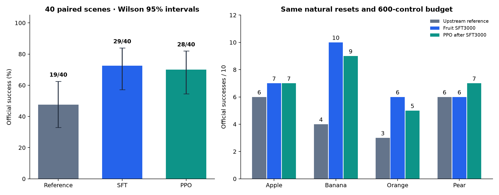
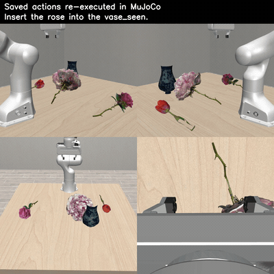
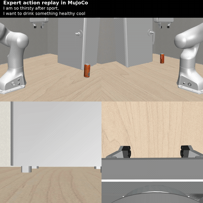
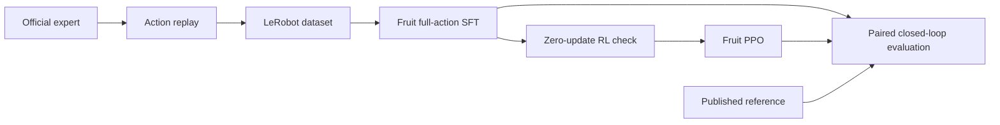

<h1 align="center">Pi05-VLABench</h1>

<p align="center">
  <strong>π0.5 imitation learning and reinforcement learning in VLABench</strong><br>
  Expert demonstrations · LeRobot datasets · Full-action SFT · PPO · Closed-loop evaluation
</p>

<p align="center">
  <strong>English</strong> &nbsp;|&nbsp; <a href="README.zh-CN.md">简体中文</a>
</p>

<p align="center">
  <a href="https://github.com/Turbo176/Pi05-VLABench/actions/workflows/verify-evidence.yml"></a>
</p>

<p align="center">
  <a href="#demos">🎬 Demos</a> ·
  <a href="#results">📊 Results</a> ·
  <a href="#training">📈 Training</a> ·
  <a href="#data">🦾 Skills & data</a><br>
  <a href="#pipeline">🧩 Architecture</a> ·
  <a href="#engineering">🔍 Engineering</a> ·
  <a href="#quickstart">🚀 Quickstart</a> ·
  <a href="#experiments">🧪 Experiments</a> ·
  <a href="#credits">📚 Credits</a>
</p>

A robot-learning project using official VLABench tasks and controllers. The latest fruit experiment connects replay-verified expert data, full-action π0.5 SFT, autonomous evaluation, and PPO from the exact same SFT checkpoint.

| SFT data | Policy updates | RL evidence | Evaluation |
| :---: | :---: | :---: | :---: |
| **47 episodes / 6,986 frames** | **3,000 SFT updates** | **21 saved actor updates** | **40 paired held-out scenes** |

The current learned policy covers fruit selection. The repository also retains the earlier shared fruit/flower experiment and three-skill expert replay pipeline. [System design and model/data cards](docs/system-design.md)

<a id="demos"></a>

## 🎬 Autonomous fruit selection

Same reserved scene, seed **7001**, with the literal instruction **“Put the orange into the plate_seen”**. These are fresh autonomous policy rollouts. The illustrative scene was chosen after aggregate scoring; all forty outcomes remain in the results.

| Upstream VLABench reference | Fruit full-action SFT3000 | PPO from the same SFT |
| :---: | :---: | :---: |
| [](media/policy/fruit-full-action-v3-base-7001.mp4?raw=true) | [](media/policy/fruit-full-action-v3-sft-7001.mp4?raw=true) | [](media/policy/fruit-full-action-v3-ppo-7001.mp4?raw=true) |
| Failure · 600 controls | Success · 154 controls | Success · 194 controls |

MP4s contain the complete rollout at 1024 × 1024 and 10 Hz. GIFs preview up to 20 seconds at normal speed. Every recording matches the scored episode's initial policy images and complete action hash. [Video verification](docs/experiments/2026-11-24/fruit-full-action-v3/evidence/video-verification.json)

<a id="results"></a>

## 📊 Closed-loop results

Forty reserved natural resets, ten each for apple, banana, orange and pear. All policies use the same initial physics, policy images, instruction, official Franka controller and 600-control budget. At 10 Hz, the policy predicts ten actions and executes five per observation. Development selection and model hashes were locked before reserved-test inference.

| Policy | Official successes | Success rate | Wilson 95% interval |
| --- | ---: | ---: | ---: |
| Upstream VLABench reference | 19/40 | 47.5% | 32.9–62.5% |
| Fruit full-action SFT3000 | 29/40 | 72.5% | 57.2–83.9% |
| PPO after the same SFT3000 | 28/40 | 70% | 54.6–81.9% |

PPO gained **3** scenes and lost **4** relative to SFT; paired exact McNemar p=1. These are measurements from one training seed and a fixed forty-scene suite. [All outcomes, failure types and protocol](docs/experiments/2026-11-24/fruit-full-action-v3/README.md)



The reference is already fine-tuned upstream on VLABench and retains its original normalization. SFT/PPO share new action statistics fitted only on training data. Official success checks that the target fruit enters the plate region; released, settled placement is not an additional requirement.

The full two-reward PPO study used **5,884 environment controls**, including critic warmup and a rejected update iteration. The selected checkpoint retains **21 actor optimizer steps**; all 182 action-expert and eight action-head tensors changed. [Saved-actor audit](docs/experiments/2026-11-24/fruit-full-action-v3/evidence/potential/saved-actor-audit.json) · [Every paired scene](docs/experiments/2026-11-24/fruit-full-action-v3/results/paired-scenes.png)

<a id="training"></a>

## 📈 Training and rewards


SFT trains the full action expert and heads (**430,098,464 parameters**) for 3,000 updates with FP32 master AdamW; the vision-language backbone stays frozen. The plot retains every minibatch loss, including spikes. Loss is separate from closed-loop performance.

Both PPO arms start from the same SFT weights: terminal-corrected potential shaping, and one-time grasp/lift/completion rewards. The selected potential checkpoint scored 11/16 on development versus SFT's 9/16. Milestone iteration two exceeded the update guard and was rejected before saving; its cost remains included. [Reward comparison and training sources](docs/experiments/2026-11-24/fruit-full-action-v3/README.md) · [Literature review](docs/fruit-reward-review.md)

<a id="data"></a>

## 🦾 Skills and demonstration data

The official experts cover three manipulation skills: selecting and placing fruit, aligning a flower with a vase, and opening a fridge to retrieve a drink. These clips are **expert action replays** in fresh MuJoCo simulations. Learned-policy results above use the separate pose dataset below.

| 🍎 Fruit selection | 🌷 Flower insertion | 🧃 Fridge drink retrieval |
| :---: | :---: | :---: |
| [](media/demos/select-fruit-replay.mp4?raw=true) | [](media/demos/insert-flower-replay.mp4?raw=true) | [](media/demos/fridge-drink-replay.mp4?raw=true) |
| [Replay audit](docs/stage1-action-replay.json) | [Replay audit](docs/stage2-insert-flower-replay.json) | [Replay audit](docs/stage2-fridge-rgb-replay.json) |

The current fruit policy uses **45 complete expert demonstrations + two expert corrections**, 6,986 frames in total. Four validation episodes / 589 frames are isolated by initialization. Reward geometry and success labels never enter model observations. The earlier shared policy used 64 fruit/flower episodes and remains a separate historical experiment. [Data card](docs/system-design.md#data-card) · [Collection records](docs/stage2.md)

<a id="pipeline"></a>

## 🧩 Architecture



- **Data validation.** Replay saved commands from the recorded initialization, check official success, and isolate complete episodes and initialization conditions across splits.
- **Policy interface.** Use forward, right, and wrist RGB plus the literal instruction. Measured end-effector pose and gripper state support the shared transforms and action decoder. Expert target geometry, reward, and success labels stay outside policy inputs.
- **Action alignment.** Preserve the upstream state-conditioning setting, normalization, pose decoding, ten-action horizon, and five-control execution rule across SFT and RL. The zero-update handoff compares predictions, log probabilities, and all sixteen complete development rollouts.
- **Experiment records.** Retain checkpoint hashes, frozen configurations, registered source hashes, raw outcomes, actor gradients, and parameter changes.

The pose-policy actions contain XYZ in meters, Euler angles in radians, and a gripper coordinate, decoded through the official controller. The published configuration uses `discrete_state_input=False`; state supports pose decoding rather than adding a new learned state input. [Executed policy I/O and model card](docs/system-design.md#policy-and-control-contract)

<a id="engineering"></a>

## 🔍 Engineering checks

| Question | Implemented check | Evidence |
| --- | --- | --- |
| Do dataset labels survive normalization and controller decoding? | All label windows round-trip; selected expert labels run through the same controller to official success. | [Transform and replay audit](docs/experiments/2026-11-22/pose-robustness-v2/training-contract-audit.json) |
| Does loading SFT into RL change the behavior before training? | Three observation windows and all 16 full development action sequences match before RL updates. | [Zero-update handoff](docs/experiments/2026-11-24/fruit-full-action-v3/evidence/handoff/development.json) |
| Did PPO update the VLA itself? | Compare saved policy tensors with the exact SFT parent and check optimizer steps separately from the critic. | [190-tensor actor audit](docs/experiments/2026-11-24/fruit-full-action-v3/evidence/potential/saved-actor-audit.json) |
| Where does abrupt motion appear? | Align pre-control measured poses with commands and compare quaternion rotation; a 51.3 mm target jump occurs inside an action chunk. | [Motion analysis; fix pending](docs/experiments/2026-11-23/training-and-motion/README.md) |

The project reuses upstream models, expert skills, tasks, and low-level control. Repository work covers data alignment, training/rollout integration, validation, and evaluation. [Module map, settings, costs, and remaining work](docs/system-design.md)

<a id="quickstart"></a>

## 🚀 Quickstart

### Review the experiment without a GPU

From the repository root, Python 3.9+ can recompute all 120 outcomes and check exported source/evidence hashes using the standard library:

```bash
python docs/experiments/2026-11-24/fruit-full-action-v3/analyze.py \
  --evidence docs/experiments/2026-11-24/fruit-full-action-v3/evidence \
  --output docs/experiments/2026-11-24/fruit-full-action-v3/results --verify-only
```

This verifies retained evidence. Loading excluded model weights and running the simulator are separate checks. [Executed training and evaluation commands](docs/experiments/2026-11-24/fruit-full-action-v3/commands.md)

### Run an official expert demonstration

The commands below were verified on Ubuntu 22.04 under WSL2. Prepare the pinned simulator, official asset subset, and independent Python environment using the [setup guide](docs/stage1.md#setup-and-run). Run from the repository root with a fresh output directory.

```bash
bash scripts/run_wsl.sh probe --task select_fruit --seed 42
bash scripts/run_wsl.sh collect --task select_fruit --seed 42 --output runs/select_fruit-42
bash scripts/run_wsl.sh replay runs/select_fruit-42/episode.h5
```

`expert.mp4` records the expert. `action_replay.mp4` records a fresh simulation executing saved actions. Model training and evaluation require the separate GPU setup in the experiment report.

<a id="experiments"></a>

## 🧪 Experiments and reproduction

| Record | Contents |
| --- | --- |
| [Full-action fruit SFT + PPO](docs/experiments/2026-11-24/fruit-full-action-v3/README.md) | 3,000-update SFT, two reward arms, paired test, actor audit and reproducible sources |
| [Forty-scene fruit follow-up](docs/experiments/2026-11-24/fruit-recovery-v2/README.md) | Historical SFT180 → PPO, balanced paired test, costs and raw evidence |
| [Archived fruit pilot](docs/experiments/2026-11-22/fruit-completion-v1/README.md) | Original SFT90/PPO checkpoints, ten-scene and language evaluation |
| [Training and motion analysis](docs/experiments/2026-11-23/training-and-motion/README.md) | Loss and gradient plots, time-aligned motion measurements, reproducible plotting command |
| [System design and model/data cards](docs/system-design.md) | Implementation boundaries, exact interfaces, training scope, costs, and requirement coverage |
| [CPU verification and overview figures](docs/experiments/2026-11-23/project-overview/README.md) | Executable integrity checks, raw outcome aggregation, and data coverage |
| [Reward review](docs/fruit-reward-review.md) | Actual reward, literature, and staged-reward rationale |
| [Expert data and LeRobot export](docs/stage2.md) | Collection, replay checks, dataset fields, and split audits |
| [Earlier experiments](docs/experiments/2026-11-22/pose-robustness-v2/README.md) | Previous interfaces, diagnostic runs, and their separate results |

[Script guide](scripts/README.md) lists the entry points for collection, conversion, SFT, PPO, evaluation, and analysis. The current frozen settings are retained with the [experiment evidence](docs/experiments/2026-11-24/fruit-full-action-v3/evidence/ppo-plan.json); `configs/` preserves historical protocols and reference-evaluator defaults. `media/` holds the three expert replays and the final paired policy videos. Weights, source datasets, assets, caches, and credentials remain outside Git.

<a id="credits"></a>

## 📚 Credits and license

Built on VLABench, MuJoCo, LeRobot, OpenPI, and RLinf. Project code uses the MIT license; assets and model checkpoints retain their upstream terms. [Pinned revisions and attribution](docs/upstream.md) · [MIT license](LICENSE)
