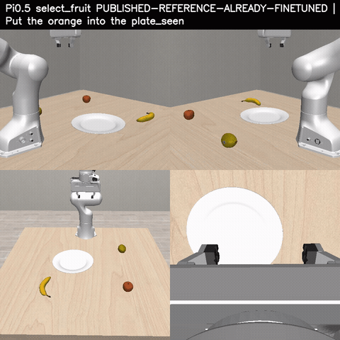
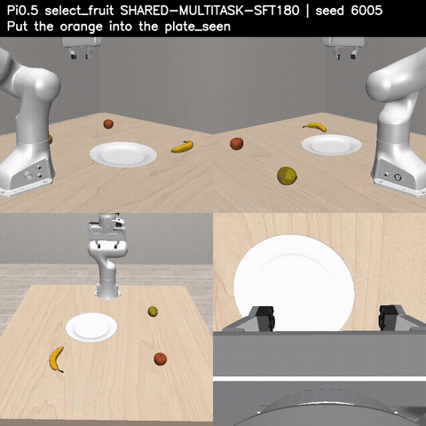
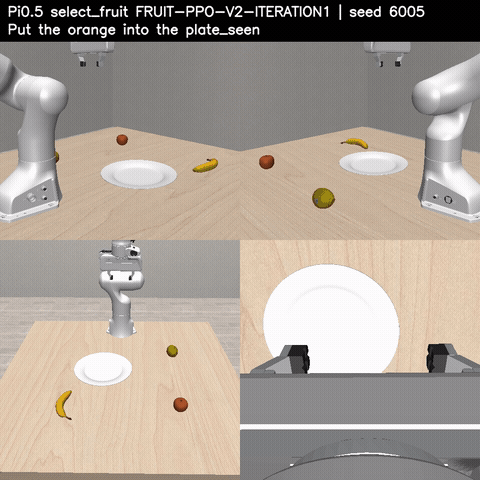
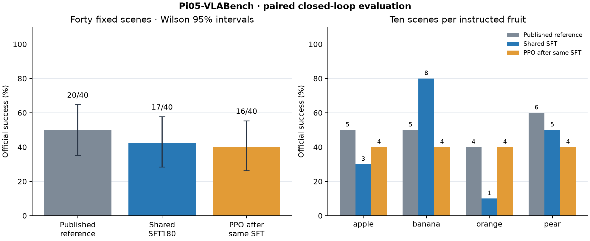
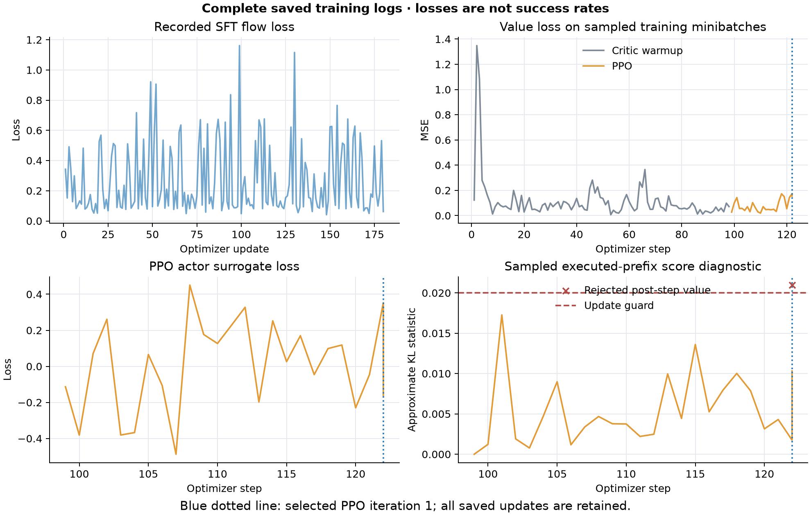
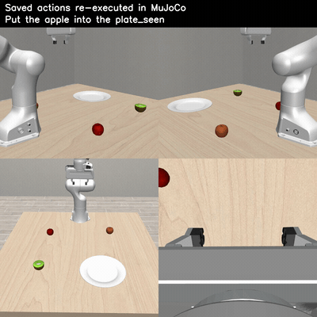
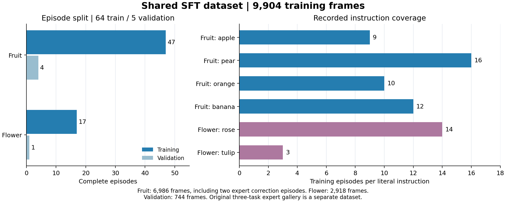
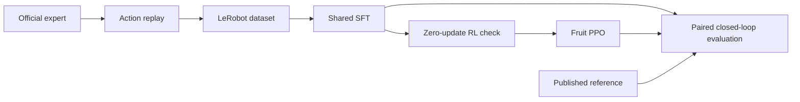

<h1 align="center">Pi05-VLABench</h1>

<p align="center">
  <strong>π0.5 imitation learning and reinforcement learning in VLABench</strong><br>
  Expert demonstrations · LeRobot datasets · Multitask SFT · PPO · Closed-loop evaluation
</p>

<p align="center">
  <strong>English</strong> &nbsp;|&nbsp; <a href="README.zh-CN.md">简体中文</a>
</p>

<p align="center">
  <a href="https://github.com/Turbo176/Pi05-VLABench/actions/workflows/verify-evidence.yml"></a>
</p>

<p align="center">
  <a href="#demos">🎬 Demos</a> ·
  <a href="#results">📊 Results</a> ·
  <a href="#training">📈 Training</a> ·
  <a href="#data">🦾 Skills & data</a><br>
  <a href="#pipeline">🧩 Architecture</a> ·
  <a href="#engineering">🔍 Engineering</a> ·
  <a href="#quickstart">🚀 Quickstart</a> ·
  <a href="#experiments">🧪 Experiments</a> ·
  <a href="#credits">📚 Credits</a>
</p>

A reproducible robot-learning project built around official VLABench tasks and controllers. The completed fruit-selection workflow connects verified expert data, a shared fruit/flower π0.5 SFT checkpoint, autonomous evaluation, and PPO updates to the same policy.

| Training data | Shared policy | RL update | Evaluation |
| :---: | :---: | :---: | :---: |
| **64 episodes / 9,904 frames** | **Fruit + flower SFT** | **224 actor tensors changed** | **40 paired held-out fruit scenes** |

The repository covers data validation, model adaptation, SFT-to-RL compatibility, and paired evaluation around the official robot controller. The completed learned-policy workflow is fruit selection; flower insertion and fridge retrieval remain extensions. [System design and implementation](docs/system-design.md)

<a id="demos"></a>

## 🎬 Autonomous fruit selection

Same held-out scene, seed 6005, with the literal instruction **“Put the orange into the plate_seen”**. All clips show fresh autonomous rollouts. This scene was selected to illustrate successful SFT/PPO behavior; all forty scenes are included in the aggregate results.

| Published VLABench reference | Shared multitask SFT180 | PPO from the same SFT checkpoint |
| :---: | :---: | :---: |
| [](media/policy/fruit-recovery-v2-base-6005.mp4?raw=true) | [](media/policy/fruit-recovery-v2-sft-6005.mp4?raw=true) | [](media/policy/fruit-recovery-v2-ppo-6005.mp4?raw=true) |
| Failure · 600 controls | Success · 133 controls | Success · 145 controls |

[Video verification and selection](docs/experiments/2026-11-24/fruit-recovery-v2/evidence/video-verification.json) · [Earlier paired example](docs/experiments/2026-11-22/fruit-completion-v1/README.md)

MP4s contain the complete rollout at 1024 × 1024 and 10 Hz. GIFs preview up to 15 seconds at normal speed and 10 fps. Each recording matches the scored episode's initial policy images and complete action hash. These clips illustrate one scene; aggregate results follow below.

<a id="results"></a>

## 📊 Closed-loop results

Forty paired held-out fruit scenes, with ten naturally reset targets each for apple, banana, orange and pear. Every policy uses the same initialization, policy cameras, instruction, official Franka controller, and 600-control budget. Control runs at 10 Hz, predicting ten actions and executing five per observation. The PPO checkpoint was frozen on development before the reference/SFT test outcomes were opened.

| Policy | Official successes | Success rate | Wilson 95% interval |
| --- | ---: | ---: | ---: |
| Published VLABench reference | 20/40 | 50% | 35.2–64.8% |
| Shared multitask SFT180 | 17/40 | 42.5% | 28.5–57.8% |
| Fruit PPO1 after SFT180 | 16/40 | 40% | 26.3–55.4% |

The reference is a published VLABench π0.5 model already fine-tuned upstream. This follow-up demonstrates an executable SFT-to-PPO workflow but does **not** show an overall success-rate improvement. Relative to SFT180, PPO gained five scenes and lost six. Official success checks that the target fruit is inside the plate region; it does not require gripper release or settled placement. [Per-fruit outcomes, failures and protocol](docs/experiments/2026-11-24/fruit-recovery-v2/README.md)



The saved PPO checkpoint used **6,897 training controls**, including critic warmup, with **24 actor and 122 critic optimizer steps**. Independent checkpoint comparison verifies changes to **224 actor tensors**, including action-expert LoRA and action heads. SFT180 sampled 1,440 training windows; both are short experiments rather than convergence claims. [Handoff check](docs/experiments/2026-11-24/fruit-recovery-v2/evidence/zero-update-handoff.json) · [Actor update audit](docs/experiments/2026-11-24/fruit-recovery-v2/results/saved-checkpoint-audit.json) · [All paired outcomes](docs/experiments/2026-11-24/fruit-recovery-v2/results/paired-scenes.png)

<a id="training"></a>

## 📈 Training signals



The figure shows all 180 SFT updates, critic warmup, PPO actor/value losses, and the sampled prefix-score update guard, including the rejected update. Loss varies across sampled minibatches; closed-loop success remains the performance measure.

[Full follow-up report and development curve](docs/experiments/2026-11-24/fruit-recovery-v2/README.md) · [Earlier motion analysis](docs/experiments/2026-11-23/training-and-motion/README.md) · [Reward design and literature](docs/fruit-reward-review.md)

<a id="data"></a>

## 🦾 Skills and demonstration data

The official experts cover three manipulation skills: selecting and placing fruit, aligning a flower with a vase, and opening a fridge to retrieve a drink. These clips are **expert action replays** in fresh MuJoCo simulations. Learned-policy results above use the separate pose dataset below.

| 🍎 Fruit selection | 🌷 Flower insertion | 🧃 Fridge drink retrieval |
| :---: | :---: | :---: |
| [](media/demos/select-fruit-replay.mp4?raw=true) | [](media/demos/insert-flower-replay.mp4?raw=true) | [](media/demos/fridge-drink-replay.mp4?raw=true) |
| [Replay audit](docs/stage1-action-replay.json) | [Replay audit](docs/stage2-insert-flower-replay.json) | [Replay audit](docs/stage2-fridge-rgb-replay.json) |



The current shared SFT has 47 fruit and 17 flower training episodes, plus five separate validation episodes / 744 frames. Fruit includes two expert correction episodes. The older joint-space gallery dataset contains 60 episodes / 16,520 frames and is not mixed into these totals. [Current data card](docs/system-design.md#data-card) · [Collection and export records](docs/stage2.md)

<a id="pipeline"></a>

## 🧩 Architecture



- **Data validation.** Replay saved commands from the recorded initialization, check official success, and isolate complete episodes and initialization conditions across splits.
- **Policy interface.** Use forward, right, and wrist RGB plus the literal instruction. Measured end-effector pose and gripper state support the shared transforms and action decoder. Expert target geometry, reward, and success labels stay outside policy inputs.
- **Action alignment.** Preserve the upstream state-conditioning setting, normalization, pose decoding, ten-action horizon, and five-control execution rule across SFT and RL. The zero-update handoff compares predictions, log probabilities, and an entire closed-loop rollout.
- **Experiment records.** Retain checkpoint hashes, frozen configurations, registered source hashes, raw outcomes, actor gradients, and parameter changes.

The pose-policy actions contain XYZ in meters, Euler angles in radians, and a gripper coordinate, decoded through the official controller. The published configuration uses `discrete_state_input=False`; state supports pose decoding rather than adding a new learned state input. [Executed policy I/O and model card](docs/system-design.md#policy-and-control-contract)

<a id="engineering"></a>

## 🔍 Engineering checks

| Question | Implemented check | Evidence |
| --- | --- | --- |
| Do dataset labels survive normalization and controller decoding? | All label windows round-trip; selected expert labels run through the same controller to official success. | [Transform and replay audit](docs/experiments/2026-11-22/pose-robustness-v2/training-contract-audit.json) |
| Does loading SFT into RL change the behavior before training? | Three real observation windows match exactly under shared decoding; one paired closed-loop success repeats. | [Zero-update handoff](docs/experiments/2026-11-24/fruit-recovery-v2/evidence/zero-update-handoff.json) |
| Did PPO update the VLA itself? | Compare saved policy tensors with the exact SFT parent and check optimizer steps separately from the critic. | [224-tensor actor audit](docs/experiments/2026-11-24/fruit-recovery-v2/results/saved-checkpoint-audit.json) |
| Where does abrupt motion appear? | Align pre-control measured poses with commands and compare quaternion rotation; a 51.3 mm target jump occurs inside an action chunk. | [Motion analysis; fix pending](docs/experiments/2026-11-23/training-and-motion/README.md) |

The project reuses upstream models, expert skills, tasks, and low-level control. Repository work covers data alignment, training/rollout integration, validation, and evaluation. [Module map, settings, costs, and remaining work](docs/system-design.md)

<a id="quickstart"></a>

## 🚀 Quickstart

### Review the experiment without a GPU

From the repository root, Python 3.9+ can verify the exported evidence and recompute the paired scores with no additional packages:

```bash
python scripts/review_fruit_experiment.py
```

This verifies the archived ten-scene pilot: 45 retained files, 11 registered source/configuration hashes and all 57 ordinary/language evaluation episodes. The current forty-scene comparison has a separate standard-library check; run from the repository root in Bash:

```bash
report=docs/experiments/2026-11-24/fruit-recovery-v2
python "$report/analyze.py" --verify-only --cases "$report/evidence/test-cases.jsonl" \
  --base "$report/evidence/test-reference.jsonl" --sft "$report/evidence/test-sft.jsonl" \
  --ppo "$report/evidence/test-ppo.jsonl" --selection "$report/evidence/final-selection.json" \
  --output "$report/results"
```

The new check recomputes all **120 raw test outcomes**, verifies paired interfaces and saved file hashes, and checks the recorded actor/critic updates and interaction costs. It reads exported evidence; independently reloading the excluded model weights is a separate check. [Reproduction commands](docs/experiments/2026-11-24/fruit-recovery-v2/commands.md)

### Run an official expert demonstration

The commands below were verified on Ubuntu 22.04 under WSL2. Prepare the pinned simulator, official asset subset, and independent Python environment using the [setup guide](docs/stage1.md#setup-and-run). Run from the repository root with a fresh output directory.

```bash
bash scripts/run_wsl.sh probe --task select_fruit --seed 42
bash scripts/run_wsl.sh collect --task select_fruit --seed 42 --output runs/select_fruit-42
bash scripts/run_wsl.sh replay runs/select_fruit-42/episode.h5
```

`expert.mp4` records the expert. `action_replay.mp4` records a fresh simulation executing saved actions. Model training and evaluation require the separate GPU setup in the experiment report.

<a id="experiments"></a>

## 🧪 Experiments and reproduction

| Record | Contents |
| --- | --- |
| [Forty-scene fruit follow-up](docs/experiments/2026-11-24/fruit-recovery-v2/README.md) | Reward comparison, SFT180 → PPO, balanced paired test, costs and raw evidence |
| [Archived fruit pilot](docs/experiments/2026-11-22/fruit-completion-v1/README.md) | Original SFT90/PPO checkpoints, ten-scene and language evaluation |
| [Training and motion analysis](docs/experiments/2026-11-23/training-and-motion/README.md) | Loss and gradient plots, time-aligned motion measurements, reproducible plotting command |
| [System design and model/data cards](docs/system-design.md) | Implementation boundaries, exact interfaces, training scope, costs, and requirement coverage |
| [CPU verification and overview figures](docs/experiments/2026-11-23/project-overview/README.md) | Executable integrity checks, raw outcome aggregation, and data coverage |
| [Reward review](docs/fruit-reward-review.md) | Actual reward, literature, and an untrained staged-reward proposal |
| [Expert data and LeRobot export](docs/stage2.md) | Collection, replay checks, dataset fields, and split audits |
| [Earlier experiments](docs/experiments/2026-11-22/pose-robustness-v2/README.md) | Previous interfaces, diagnostic runs, and their separate results |

[Script guide](scripts/README.md) lists the entry points for collection, conversion, SFT, PPO, evaluation, and analysis. `configs/` contains the frozen fruit PPO/evaluation settings and the reference evaluator's default control settings. `media/` holds the three expert replays and the final paired policy videos. Weights, source datasets, assets, caches, and credentials remain outside Git.

<a id="credits"></a>

## 📚 Credits and license

Built on VLABench, MuJoCo, LeRobot, OpenPI, and RLinf. Project code uses the MIT license; assets and model checkpoints retain their upstream terms. [Pinned revisions and attribution](docs/upstream.md) · [MIT license](LICENSE)
