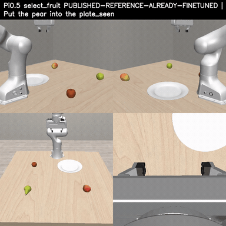
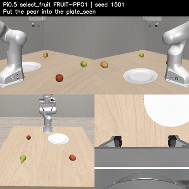
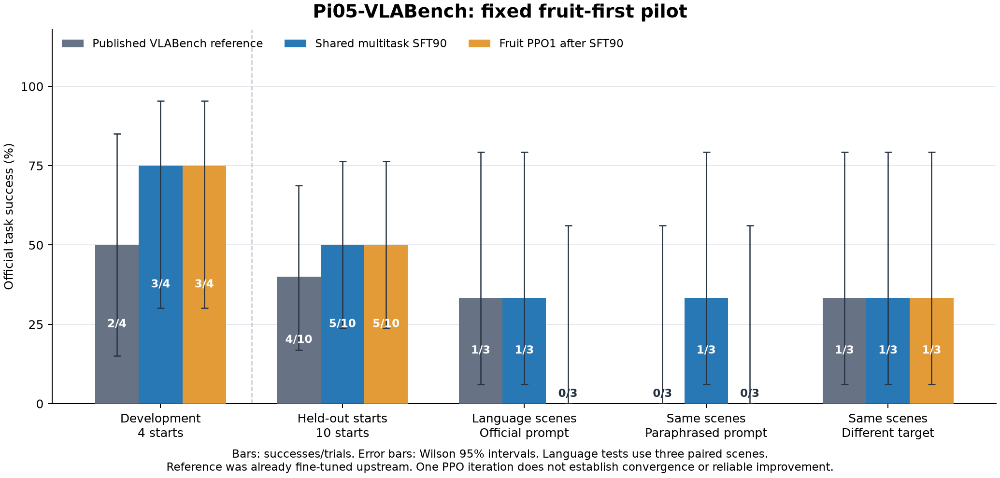

<h1 align="center">Pi05-VLABench</h1>

<p align="center">
  <strong>Multitask robot learning with π0.5 on VLABench</strong><br>
  Official expert demonstrations · LeRobot datasets · Multitask SFT · PPO · Closed-loop evaluation
</p>

<p align="center">
  <strong>🧭 Contents</strong><br>
  <a href="#demos">🎬 Demos</a> ·
  <a href="#data-pipeline">🧩 Data pipeline</a> ·
  <a href="#tasks-and-results">📊 Results</a><br>
  <a href="#reproduce-the-fruit-demo">🚀 Quickstart</a> ·
  <a href="#project-layout">📂 Project layout</a> ·
  <a href="#dependencies-and-license">📚 Credits</a>
</p>

<a name="demos"></a>

## 🎬 Demos

### 🍐 Current learned-policy comparison

Same held-out scene and instruction, seed 1501: **“Put the pear into the plate_seen.”** Each MP4 is a fresh autonomous model rollout with verified initial policy images and complete action hashes. The first numerical reserved seed was chosen for recording before viewing test results.

| Published VLABench reference | Shared multitask SFT90 | Fruit PPO1 after the same SFT |
| :---: | :---: | :---: |
| [](media/policy/fruit-completion-v1-base-1501.mp4?raw=true) | [](media/policy/fruit-completion-v1-sft-1501.mp4?raw=true) | [](media/policy/fruit-completion-v1-ppo-1501.mp4?raw=true) |
| Failure · 600 controls | Success · 160 controls | Success · 160 controls |

MP4s: 1024 × 1024, four display cameras, original 10 Hz timing. GIF previews: 2× playback. Only display resolution changed; policy cameras and actions remain matched to quantitative results. The reference model was already fine-tuned upstream. This example illustrates the selected scene, not an aggregate PPO improvement. [Experiment and raw evidence](docs/experiments/2026-11-22/fruit-completion-v1/README.md)

### 🦾 Official expert action replays

A Franka arm selects fruit, inserts a flower into a vase, and retrieves a drink from a fridge. Each clip shows a fresh MuJoCo simulation executing saved commands from the official VLABench expert. This gallery shows one expert replay per task. The separate LeRobot training split contains 20 successful demonstrations per task, for 60 episodes and 16,520 frames. Each training frame pairs camera images and measured robot state with the expert action at that tick. [Training split audit](docs/stage2-expansion-06.json)

| 🍎 Fruit selection | 🌷 Flower insertion | 🧃 Fridge drink retrieval |
| :---: | :---: | :---: |
| [](media/demos/select-fruit-replay.mp4?raw=true) | [](media/demos/insert-flower-replay.mp4?raw=true) | [](media/demos/fridge-drink-replay.mp4?raw=true) |
| [▶ Full replay · 13.3 s](media/demos/select-fruit-replay.mp4?raw=true) | [▶ Full replay · 18.2 s](media/demos/insert-flower-replay.mp4?raw=true) | [▶ Full replay · 47.8 s](media/demos/fridge-drink-replay.mp4?raw=true) |
| [Replay report · seed 42](docs/stage1-action-replay.json) | [Replay report · seed 42](docs/stage2-insert-flower-replay.json) | [Replay report · seed 43](docs/stage2-fridge-rgb-replay.json) |

The full MP4s show all four cameras at the original 10 Hz timing. The GIF previews run at 2× for fruit and flower and 4× for the fridge.

### 🍊 Earlier matched fruit rollouts

These clips belong to the earlier rendering profile and checkpoint, not the current corrected-rendering experiment. The 90-update multitask SFT policy placed the orange on the plate in 191 controls on development seed 1203. The PPO policy reached the 600-control limit on the same start. [SFT success](media/policy/sft-pose-select_fruit-1203.mp4?raw=true) · [PPO failure](media/policy/ppo-pose-select_fruit-1203.mp4?raw=true)

On development seed 1201, the PPO policy placed the banana on the plate in 134 controls. [PPO success](media/policy/ppo-pose-select_fruit-1201.mp4?raw=true)

### 👀 Initial policy rollouts

The nine recordings below come from the initial joint-space pilot. Each policy used held-out seed 1001 at 10 Hz and reached the 600-step limit without task success.

| Task | π0.5 base with adapter | Multitask SFT | Fruit PPO after SFT |
| --- | --- | --- | --- |
| 🍎 Fruit selection | [▶ Base](media/policy/base-select_fruit-1001.mp4?raw=true) | [▶ SFT](media/policy/sft-select_fruit-1001.mp4?raw=true) | [▶ PPO](media/policy/ppo-select_fruit-1001.mp4?raw=true) |
| 🌷 Flower insertion | [▶ Base](media/policy/base-insert_flower-1001.mp4?raw=true) | [▶ SFT](media/policy/sft-insert_flower-1001.mp4?raw=true) | [▶ PPO](media/policy/ppo-insert_flower-1001.mp4?raw=true) |
| 🧃 Fridge drink retrieval | [▶ Base](media/policy/base-take_out_cool_drink-1001.mp4?raw=true) | [▶ SFT](media/policy/sft-take_out_cool_drink-1001.mp4?raw=true) | [▶ PPO](media/policy/ppo-take_out_cool_drink-1001.mp4?raw=true) |

<a name="data-pipeline"></a>

## 🧩 Data pipeline

**🦾 Official expert → 🔁 Action replay and success check → 📦 LeRobot export**

- **Record.** The current pose-policy dataset stores forward, right, and wrist RGB, the original instruction, measured end-effector pose and gripper state, and the expert's Cartesian pose targets at each 10 Hz control step. Positions use meters in the robot base frame, Euler angles use radians, and the action gripper coordinate selects open or closed fingers through the unchanged official controller.
- **Replay.** Restore the recorded initialization, execute the saved commands, and check the simulator trace and official task success.
- **Export.** Keep successful, replay-verified episodes for training. Split by complete episode and initialization. The three RGB cameras, measured robot state, and instruction form the policy input whitelist. Expert target geometry, rewards, and success labels are excluded.

The original local gallery and joint-space pilot retain four cameras and nine actuator targets. They are separate from the current three-camera, seven-coordinate pose export. The current verified base split has 63 training episodes and six validation episodes; newly verified expert corrections and demonstrations are appended in separate exports so their provenance remains visible.

[Collection and LeRobot export](docs/stage2.md) · [Policy inputs and normalization](docs/policy-io.md)

<a name="tasks-and-results"></a>

## 📊 Results and training status

**Fruit pipeline completed on November 23, 2026 (Asia/Shanghai): expert demonstrations → LeRobot export → SFT → closed-loop evaluation → PPO → paired evaluation.** Flower insertion and fridge retrieval remain incomplete after the shared SFT checkpoint scored fruit 3/4 and flower 0/4 on development starts. The evaluated SFT is one real multitask model trained on **64 complete fruit/flower episodes / 9,904 frames**, with five separate validation episodes / 744 frames. A single-demonstration diagnostic model is never used as its parent.

The current reference is the published VLABench π0.5 Primitive model, **already fine-tuned upstream**. All current comparisons use reproducible camera rendering with MSAA disabled, the same official Franka pose controller, 10 Hz, a ten-action horizon, five executed controls per prediction, and a 600-control budget.

| Fruit development, fixed starts 1201–1204 | Official successes | Wilson 95% interval |
| --- | ---: | ---: |
| Published VLABench reference | 2/4 | 15.0–85.0% |
| Shared multitask SFT, 90 updates | 3/4 | 30.1–95.4% |
| Fruit PPO from that exact SFT checkpoint | 3/4 | 30.1–95.4% |

These development starts informed checkpoint selection. Their scores are not held-out estimates or evidence of a statistically established improvement. The single PPO iteration did not increase development success. A fresh zero-update SFT→RL handoff passed: predictions and shared action decoding were identical, rollout log probabilities matched, and the 135-control development-1201 success reproduced exactly.

The bounded PPO experiment completed one iteration on training starts 1301/1302, using 731 environment controls and 19 optimizer steps. Nonzero actor gradients and actual changes to both action-expert LoRA and action heads were measured. The saved PPO model was frozen before held-out testing. Flower and fridge remain unfinished.

| Ten fixed held-out starts, 1501–1510 | Official successes | Wilson 95% interval |
| --- | ---: | ---: |
| Published VLABench reference | 4/10 | 16.8–68.7% |
| Shared multitask SFT90 | 5/10 | 23.7–76.3% |
| Fruit PPO1 after that SFT | 5/10 | 23.7–76.3% |

SFT improved three starts and regressed on two relative to the reference. PPO improved two starts and regressed on two relative to SFT; overall success stayed unchanged. The small sample and overlapping intervals do not establish a reliable improvement. Every failure remains in the [paired ordinary results](docs/experiments/2026-11-22/fruit-completion-v1/ordinary-comparison.json).

| Three paired language scenes, 1601–1603 | Published reference | Shared SFT90 | Fruit PPO1 |
| --- | ---: | ---: | ---: |
| Official instruction | 1/3 | 1/3 | 0/3 |
| Paraphrased instruction | 0/3 | 1/3 | 0/3 |
| Same scene, different target | 1/3 | 1/3 | 1/3 |

Each row uses the same three scenes; these are not nine independent scenes. Changed prompts changed actions, but no scene succeeded for both the official target and alternate target. These tests do not establish robust language following. PPO lost the SFT successes for the official and paraphrased instructions. No further training or checkpoint selection followed these tests.



[Complete comparison and language evidence](docs/experiments/2026-11-22/fruit-completion-v1/comparison.json) · [Evidence file manifest](docs/experiments/2026-11-22/fruit-completion-v1/evidence-export.json)

The completed PPO reward was official success plus distance progress, without explicit grasp/lift milestones. A [reward review and proposed staged-reward experiment](docs/fruit-reward-review.md) records the measured reward sums, limitations and possible next steps. The proposed rewards have not been implemented or trained.

[🍎 Current fruit experiment, fixed settings and commands](docs/experiments/2026-11-22/fruit-completion-v1/README.md) · [📋 PPO configuration](configs/ppo-fruit-completion-v1.json) · [🧪 Fixed evaluation](configs/evaluation-fruit-completion-v1.json)

### 🗃️ Earlier experiments and diagnostics

Earlier results remain available with their own checkpoints, rendering profiles and failures. They are not combined with the active experiment. The previous three-task pilot, the original pose-policy PPO run, and the corrected-rendering comparisons are documented in the [experiment archive](docs/experiments/2026-11-22/pose-robustness-v2/README.md) and [earlier shared pose run](docs/experiments/2026-11-21/failure-diagnosis/reference-aligned-fruit/shared-pose/README.md).

A separate single-demonstration diagnostic reproduced the seen fruit-42 task three times after 100 SFT updates, then failed at update 300. This verifies that autonomous imitation can work on one seen start; it is not a task-level success rate. [SFT diagnostic success video](media/policy/msaa0-sft-imitation100-fruit-training-42-success.mp4?raw=true). The shared SFT90 also failed that seen start, despite succeeding on three development starts; this limitation is retained in the archive.

The original local LeRobot split contains 60 successful expert episodes / 16,520 frames. It belongs to the original joint-space pipeline and is separate from the current pose-policy export. Expert screening achieved 22/22 fruit, 22/78 flower and 21/55 fridge successes before stopping at each collection target. Expert collection success is not learned-policy success. [Dataset and screening records](docs/stage2.md)

<a name="reproduce-the-fruit-demo"></a>

## 🚀 Quickstart

Reproduce the fruit demonstration on Ubuntu 22.04 under WSL2. Prepare the pinned simulator checkout, official asset subset, and Python environment using the [local setup guide](docs/stage1.md#setup-and-run). Then run these commands from the repository root with a fresh output directory.

```bash
bash scripts/run_wsl.sh probe --task select_fruit --seed 42
bash scripts/run_wsl.sh collect --task select_fruit --seed 42 --output runs/select_fruit-42
bash scripts/run_wsl.sh replay runs/select_fruit-42/episode.h5
```

`expert.mp4` records the expert run. `action_replay.mp4` shows a fresh simulator executing the saved actuator commands.

<a name="project-layout"></a>

## 📂 Project layout

| Path | Contents |
| --- | --- |
| [`scripts/`](scripts/) | Expert capture, action replay, LeRobot export, SFT, PPO, and closed-loop evaluation |
| [`configs/`](configs/) | Held-out evaluation seeds and paired fruit prompts |
| [`docs/`](docs/) | Reproduction guides, experiment reports, and upstream version pins |
| [`media/demos/`](media/demos/) | Expert action replays and previews |
| [`media/policy/`](media/policy/) | Held-out base, SFT, and PPO rollouts |

<a name="dependencies-and-license"></a>

## 📚 Credits and license

Built on VLABench, MuJoCo, LeRobot, OpenPI, and RLinf. Project code uses the MIT license. Assets and model checkpoints retain their upstream terms. [Upstream revisions and attribution](docs/upstream.md) · [MIT license](LICENSE)
