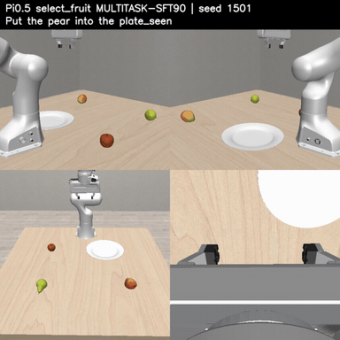
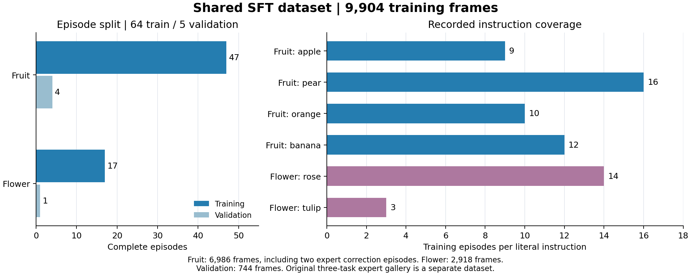
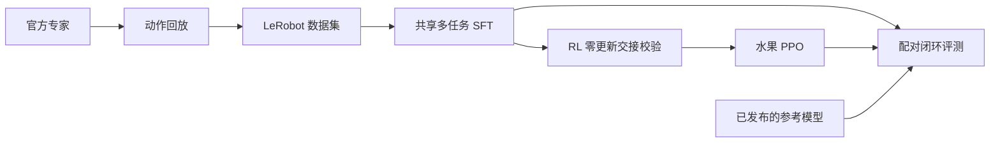

<h1 align="center">Pi05-VLABench</h1>

<p align="center">
  <strong>基于 π0.5 的 VLABench 模仿学习与强化学习</strong><br>
  专家示范 · LeRobot 数据集 · 多任务 SFT · PPO · 闭环评测
</p>

<p align="center">
  <a href="README.md">English</a> &nbsp;|&nbsp; <strong>简体中文</strong>
</p>

<p align="center">
  <a href="https://github.com/Turbo176/Pi05-VLABench/actions/workflows/verify-evidence.yml"></a>
</p>

<p align="center">
  <a href="#demos">🎬 演示视频</a> ·
  <a href="#results">📊 评测结果</a> ·
  <a href="#training">📈 训练曲线</a> ·
  <a href="#data">🦾 任务与数据</a><br>
  <a href="#pipeline">🧩 技术流程</a> ·
  <a href="#engineering">🔍 工程验证</a> ·
  <a href="#quickstart">🚀 快速开始</a> ·
  <a href="#experiments">🧪 实验与复现</a> ·
  <a href="#credits">📚 引用与许可</a>
</p>

基于官方 VLABench 任务和控制器的机器人学习项目。已完成的水果选择流程包括：专家数据验证、共享水果与插花任务的 π0.5 SFT、自主闭环评测，以及从同一个 SFT checkpoint 出发的 PPO 后训练。

| 训练数据 | 共享策略 | 强化学习更新 | 评测 |
| :---: | :---: | :---: | :---: |
| **64 条 episode / 9,904 帧** | **水果 + 插花 SFT** | **224 个 actor 参数张量发生变化** | **10 个配对的留出水果场景** |

项目围绕官方机器人控制器完成数据验证、模型适配、SFT 到 RL 的接口对齐和配对评测。目前跑通的学习策略全流程是水果选择；插花与冰箱取饮料仍待完成。[系统设计与实现](docs/system-design.md)

<a id="demos"></a>

## 🎬 水果选择自主策略演示

三个视频使用同一个留出场景，随机种子为 1501，原始指令为 **“Put the pear into the plate_seen.”**，即把梨放入盘子。视频均来自重新运行的策略自主闭环执行。

| 已发布的 VLABench 参考模型 | 共享多任务 SFT | 从同一 SFT checkpoint 训练的 PPO |
| :---: | :---: | :---: |
| [](media/policy/fruit-completion-v1-base-1501.mp4?raw=true) | [](media/policy/fruit-completion-v1-sft-1501.mp4?raw=true) | [](media/policy/fruit-completion-v1-ppo-1501.mp4?raw=true) |
| 失败 · 600 个控制步 | 成功 · 160 个控制步 | 成功 · 160 个控制步 |

[同场景参考模型视频](media/policy/fruit-completion-v1-base-1501.mp4?raw=true) · [视频一致性校验](docs/experiments/2026-11-22/fruit-completion-v1/local-video-verification.json)

MP4 保留 10 Hz 的原始时序，分辨率为 1024 × 1024；GIF 预览以 2 倍速播放。每段录像的初始策略图像和完整动作序列哈希均与计分 episode 一致。这些视频展示一个场景，整体结果见下表。

<a id="results"></a>

## 📊 闭环评测结果

评测使用 10 个固定的留出水果场景，随机种子为 1501–1510。所有策略使用相同的初始化、策略相机、语言指令、官方 Franka 控制器和 600 个控制步预算。控制频率为 10 Hz，每次观测预测 10 个动作，执行其中 5 个后重新读取观测。

| 策略 | 官方判定成功数 | 成功率 | Wilson 95% 置信区间 |
| --- | ---: | ---: | ---: |
| 已发布的 VLABench 参考模型 | 4/10 | 40% | 16.8–68.7% |
| 共享多任务 SFT90 | 5/10 | 50% | 23.7–76.3% |
| SFT90 后的水果 PPO1 | 5/10 | 50% | 23.7–76.3% |

参考模型是上游已在 VLABench 上微调的 π0.5 模型。在这组样本中，SFT 总共增加了 1 次成功；单次 PPO 迭代后的总成功数保持不变。10 个场景的统计不确定性较大。配对语言测试还观察到 PPO 退化，所有指令与结果均保存在[完整评测报告](docs/experiments/2026-11-22/fruit-completion-v1/README.md)中。


PPO 使用了 **731 个环境控制步、147 个动作块和 19 次优化器更新**。保存后的 checkpoint 对比确认 **224 个 actor 参数张量发生变化**，包括动作专家 LoRA 与动作头。[SFT 到 RL 的交接校验](docs/experiments/2026-11-22/fruit-completion-v1/handoff.json) · [Actor 参数更新审计](docs/experiments/2026-11-22/fruit-completion-v1/saved-checkpoint-update-audit.json) · [全部配对结果](docs/experiments/2026-11-22/fruit-completion-v1/ordinary-comparison.json)

<a id="training"></a>

## 📈 训练曲线


图中展示全部 90 次 SFT 更新。细线为实际记录，粗线为最近 10 次更新的滑动均值。不同采样批次的损失存在波动，策略表现仍以闭环评测为准。

[训练日志与解读](docs/experiments/2026-11-23/training-and-motion/README.md) · [动作指令与实际运动分析](docs/experiments/2026-11-23/training-and-motion/motion-audit.png) · [奖励设计与参考文献](docs/fruit-reward-review.md)

<a id="data"></a>

## 🦾 任务技能与示范数据

官方专家覆盖三种操作技能：选择并放置水果、将花与花瓶对齐并插入，以及打开冰箱取出饮料。下面的视频均为在新 MuJoCo 仿真中执行保存动作得到的**专家动作回放**。上方的学习策略结果使用另一套位姿数据集，其统计见下文。

| 🍎 水果选择 | 🌷 插花 | 🧃 冰箱取饮料 |
| :---: | :---: | :---: |
| [](media/demos/select-fruit-replay.mp4?raw=true) | [](media/demos/insert-flower-replay.mp4?raw=true) | [](media/demos/fridge-drink-replay.mp4?raw=true) |
| [回放审计](docs/stage1-action-replay.json) | [回放审计](docs/stage2-insert-flower-replay.json) | [回放审计](docs/stage2-fridge-rgb-replay.json) |



当前共享 SFT 使用 47 条水果、17 条插花训练 episode，另有独立的 5 条验证 episode，共 744 帧。水果数据包含 2 条专家纠正轨迹。早期专家演示所用的关节空间数据集包含 60 条 episode、16,520 帧，不计入当前 SFT 数据总数。[当前数据卡](docs/system-design.md#data-card) · [采集与导出记录](docs/stage2.md)

<a id="pipeline"></a>

## 🧩 技术流程



- **数据验证。** 从记录的初始化重新执行保存的动作，检查官方成功条件，并按完整 episode 与初始化条件隔离数据划分。
- **策略接口。** 使用前方、右侧和腕部 RGB，以及原始语言指令。实测末端位姿与夹爪状态用于共享变换和动作解码。专家目标几何真值、奖励与成功标签不进入策略输入。
- **动作对齐。** SFT 与 RL 保持上游的状态条件设置、归一化、位姿解码、10 动作预测范围和每次执行 5 个控制步的规则。零更新交接校验比较预测、动作对数概率和一次完整闭环执行。
- **实验记录。** 保留 checkpoint 哈希、固定配置、已登记的源码哈希、原始结果、actor 梯度与参数变化记录。

位姿策略动作包含以米为单位的 XYZ、以弧度为单位的欧拉角和夹爪坐标，并通过官方控制器解码执行。已发布配置使用 `discrete_state_input=False`；状态用于位姿解码，没有额外加入新的模型状态输入。[实际策略输入输出与模型卡](docs/system-design.md#policy-and-control-contract)

<a id="engineering"></a>

## 🔍 工程验证

| 问题 | 已实现的检查 | 记录 |
| --- | --- | --- |
| 数据标签经过归一化与控制器解码后是否一致？ | 所有标签窗口完成往返变换检查；选定专家标签经同一控制器执行并达到官方成功条件。 | [变换与回放审计](docs/experiments/2026-11-22/pose-robustness-v2/training-contract-audit.json) |
| SFT 加载到 RL 后，尚未训练时行为是否变化？ | 3 个真实观测窗口完全一致；一次配对闭环执行重复成功。 | [零更新交接校验](docs/experiments/2026-11-22/fruit-completion-v1/handoff.json) |
| PPO 是否更新了 VLA 本身？ | 将保存的策略张量与准确的 SFT 父 checkpoint 比较，并单独检查策略与 critic 的优化器更新。 | [224 个 actor 张量的更新审计](docs/experiments/2026-11-22/fruit-completion-v1/saved-checkpoint-update-audit.json) |
| 突然的动作变化出现在哪里？ | 对齐控制前的实测位姿与动作指令，使用四元数比较旋转；在一个动作块内部观察到 51.3 mm 的目标跳变。 | [运动分析；修复待验证](docs/experiments/2026-11-23/training-and-motion/README.md) |

项目复用上游模型、专家技能、任务与底层控制。仓库中的工作包括数据对齐、训练与闭环执行集成、验证和评测。[模块说明、配置、成本与待完成工作](docs/system-design.md)

<a id="quickstart"></a>

## 🚀 快速开始

### 无需 GPU 核验实验记录

在仓库根目录运行。Python 3.9+ 即可校验导出的记录并重新计算配对得分，无需安装额外依赖：

```bash
python scripts/review_fruit_experiment.py
```

该命令对照原始导出哈希检查 45 个保留文件，核验 11 个已登记源码与配置的哈希、配对观测、checkpoint 身份和保存的 actor 更新记录，并根据全部 57 条普通与语言评测 episode 重新计算结果。它不加载模型权重或重新运行仿真。[预期输出与图表复现](docs/experiments/2026-11-23/project-overview/README.md)

### 运行官方专家示范

以下命令已在 WSL2 的 Ubuntu 22.04 中验证。按[安装指南](docs/stage1.md#setup-and-run)准备固定版本的仿真器、官方资产子集和独立 Python 环境，在仓库根目录运行，并使用新的输出目录。

```bash
bash scripts/run_wsl.sh probe --task select_fruit --seed 42
bash scripts/run_wsl.sh collect --task select_fruit --seed 42 --output runs/select_fruit-42
bash scripts/run_wsl.sh replay runs/select_fruit-42/episode.h5
```

`expert.mp4` 记录专家执行；`action_replay.mp4` 记录新仿真中执行保存动作的过程。模型训练与评测需要实验报告中单独说明的 GPU 环境。

<a id="experiments"></a>

## 🧪 实验与复现

| 记录 | 内容 |
| --- | --- |
| [水果 SFT → PPO](docs/experiments/2026-11-22/fruit-completion-v1/README.md) | 固定 checkpoint、实际运行命令、评测、成本与原始记录 |
| [训练与运动分析](docs/experiments/2026-11-23/training-and-motion/README.md) | 损失与梯度曲线、时间对齐的运动测量、可复现绘图命令 |
| [系统设计及模型卡与数据卡](docs/system-design.md) | 实现范围、具体接口、训练范围、成本与需求完成情况 |
| [CPU 校验与总览图表](docs/experiments/2026-11-23/project-overview/README.md) | 可执行完整性检查、原始结果汇总与数据覆盖情况 |
| [奖励设计分析](docs/fruit-reward-review.md) | 实际奖励、参考文献，以及尚未训练验证的分阶段奖励方案 |
| [专家数据与 LeRobot 导出](docs/stage2.md) | 采集、回放检查、数据集字段与划分审计 |
| [前期实验](docs/experiments/2026-11-22/pose-robustness-v2/README.md) | 早期接口、排查实验及其独立结果 |

[脚本入口说明](scripts/README.md)列出采集、转换、SFT、PPO、评测与分析的入口。`configs/` 保留固定的水果 PPO 和评测设置，以及独立参考模型评测器的默认控制设置。`media/` 存放三种专家动作回放与最终配对策略视频。模型权重、原始数据集、资产、缓存和凭据不提交 Git。

<a id="credits"></a>

## 📚 引用与许可

基于 VLABench、MuJoCo、LeRobot、OpenPI 和 RLinf 构建。项目代码使用 MIT 许可证；资产与模型 checkpoint 遵循各自的上游条款。[固定版本与引用](docs/upstream.md) · [MIT 许可证](LICENSE)
