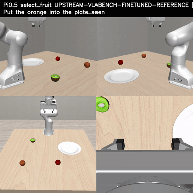
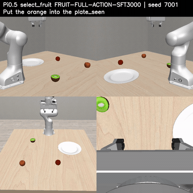
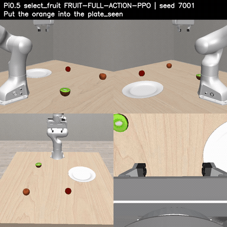
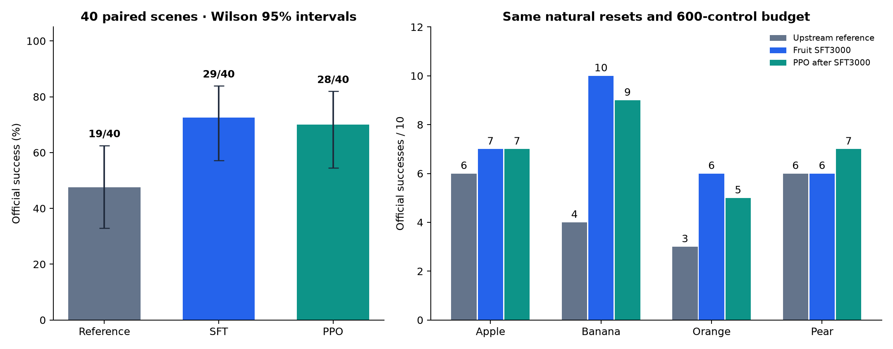
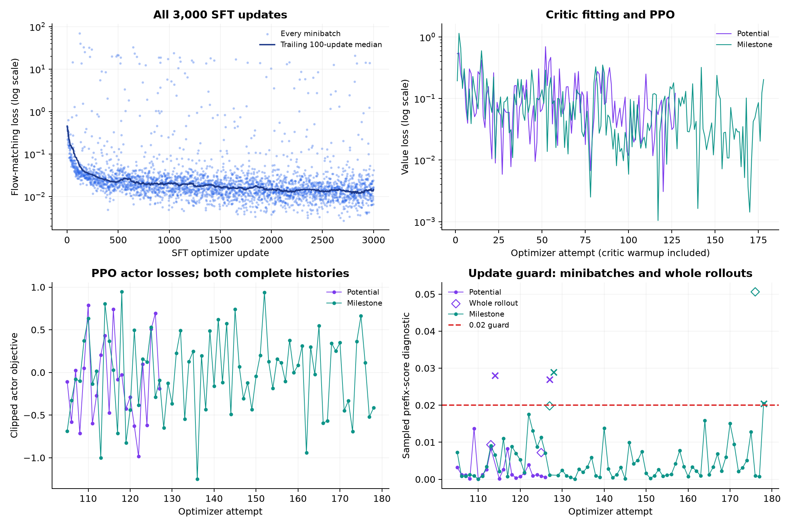
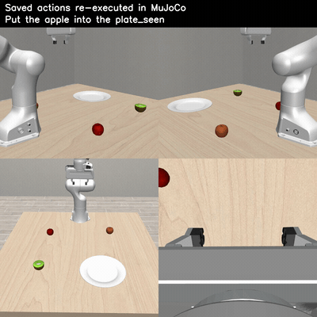
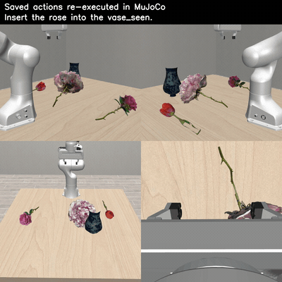
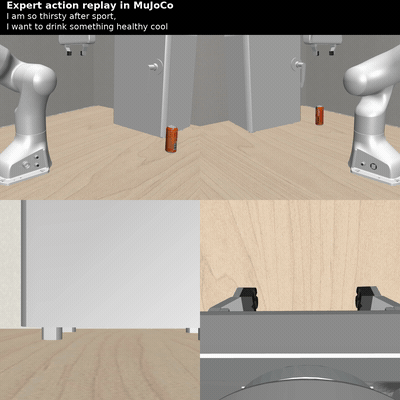
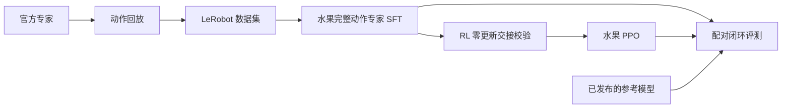

<h1 align="center">Pi05-VLABench</h1>

<p align="center">
  <strong>基于 π0.5 的 VLABench 模仿学习与强化学习</strong><br>
  专家示范 · LeRobot 数据集 · 完整动作专家 SFT · PPO · 闭环评测
</p>

<p align="center">
  <a href="README.md">English</a> &nbsp;|&nbsp; <strong>简体中文</strong>
</p>

<p align="center">
  <a href="https://github.com/Turbo176/Pi05-VLABench/actions/workflows/verify-evidence.yml"></a>
</p>

<p align="center">
  <a href="#demos">🎬 演示视频</a> ·
  <a href="#results">📊 评测结果</a> ·
  <a href="#training">📈 训练曲线</a> ·
  <a href="#data">🦾 任务与数据</a><br>
  <a href="#pipeline">🧩 技术流程</a> ·
  <a href="#engineering">🔍 工程验证</a> ·
  <a href="#quickstart">🚀 快速开始</a> ·
  <a href="#experiments">🧪 实验与复现</a> ·
  <a href="#credits">📚 引用与许可</a>
</p>

基于官方 VLABench 任务与控制器的机器人学习项目。最新水果实验已连接专家数据回放验证、完整动作专家的 π0.5 SFT、自主闭环评测，以及从同一份 SFT 权重开始的 PPO。

| SFT 数据 | 监督更新 | 强化学习证据 | 评测 |
| :---: | :---: | :---: | :---: |
| **47 条轨迹 / 6,986 帧** | **3,000 次 SFT 更新** | **保存了 21 次策略更新** | **40 个配对留出场景** |

当前学习策略覆盖水果选择。仓库另保留早期水果/插花共享策略实验，以及三种技能的专家采集与动作回放流程。[系统设计及模型卡、数据卡](docs/system-design.md)

<a id="demos"></a>

## 🎬 水果选择自主策略演示

三个视频使用同一个预留测试场景，种子 **7001**，原始指令为 **“Put the orange into the plate_seen”**。视频来自重新执行的模型自主闭环。示例在整体计分后选取，全部 40 场结果均保留。

| 上游 VLABench 参考模型 | 水果完整动作专家 SFT3000 | 从同一份 SFT 出发的 PPO |
| :---: | :---: | :---: |
| [](media/policy/fruit-full-action-v3-base-7001.mp4?raw=true) | [](media/policy/fruit-full-action-v3-sft-7001.mp4?raw=true) | [](media/policy/fruit-full-action-v3-ppo-7001.mp4?raw=true) |
| 失败 · 600 个控制步 | 成功 · 154 个控制步 | 成功 · 194 个控制步 |

MP4 保留完整过程，分辨率 1024 × 1024、10 Hz；GIF 按正常速度预览最多 20 秒。每段视频的初始策略图像及完整动作哈希均与计分轨迹一致。[视频核验记录](docs/experiments/2026-11-24/fruit-full-action-v3/evidence/video-verification.json)

<a id="results"></a>

## 📊 闭环评测结果

使用 40 个预留的自然初始化场景，苹果、香蕉、橙子和梨各 10 个。三组策略共用初始化、策略图像、指令、官方 Franka 控制器和 600 个控制步预算。控制频率 10 Hz，每次预测 10 步、执行 5 步后重新观测。开发集选型与模型哈希均在测试前固定。

| 模型 | 官方成功数 | 成功率 | Wilson 95% 置信区间 |
| --- | ---: | ---: | ---: |
| 上游 VLABench 参考模型 | 19/40 | 47.5% | 32.9–62.5% |
| 水果完整动作专家 SFT3000 | 29/40 | 72.5% | 57.2–83.9% |
| 同一 SFT 之后的 PPO | 28/40 | 70% | 54.6–81.9% |

相对 SFT，PPO 新增 **3** 个成功场景，丢失 **4** 个；配对精确 McNemar p=1。这是单个训练种子、固定 40 场测试的测量结果。[全部结果、失败类型与协议](docs/experiments/2026-11-24/fruit-full-action-v3/README.zh-CN.md)



参考模型已由上游在 VLABench 微调，并保留原始归一化；SFT/PPO 共用仅从训练集拟合的新动作统计。官方成功检查目标水果进入盘子区域，不额外要求松爪后稳定放置。

完整两组奖励实验共使用 **5,884 次环境控制**，包含 critic 预热及被拒绝的更新轮次。选中权重保留 **21 次真实策略更新**；182 个动作专家和 8 个动作头张量均发生变化。[保存权重审计](docs/experiments/2026-11-24/fruit-full-action-v3/evidence/potential/saved-actor-audit.json) · [逐场结果](docs/experiments/2026-11-24/fruit-full-action-v3/results/paired-scenes.png)

<a id="training"></a>

## 📈 训练曲线与奖励



SFT 使用 FP32 主参数 AdamW，训练完整动作专家及动作头，共 **430,098,464 个参数、3,000 次更新**；视觉语言骨干冻结。图中保留全部批次损失与尖峰，闭环表现单独计分。

两组 PPO 从同一份 SFT 权重出发：终止修正的势函数奖励，以及只支付一次的抓取/抬高/完成奖励。选中的势函数组在开发集为 11/16，SFT 为 9/16。分阶段组第二轮超过更新保护阈值，未保存，消耗仍计入总成本。[奖励对照与源码](docs/experiments/2026-11-24/fruit-full-action-v3/README.zh-CN.md) · [文献分析](docs/fruit-reward-review.md)

<a id="data"></a>

## 🦾 任务技能与示范数据

官方专家覆盖三种操作技能：选择并放置水果、将花与花瓶对齐并插入，以及打开冰箱取出饮料。下面的视频均为在新 MuJoCo 仿真中执行保存动作得到的**专家动作回放**。上方的学习策略结果使用另一套位姿数据集，其统计见下文。

| 🍎 水果选择 | 🌷 插花 | 🧃 冰箱取饮料 |
| :---: | :---: | :---: |
| [](media/demos/select-fruit-replay.mp4?raw=true) | [](media/demos/insert-flower-replay.mp4?raw=true) | [](media/demos/fridge-drink-replay.mp4?raw=true) |
| [回放审计](docs/stage1-action-replay.json) | [回放审计](docs/stage2-insert-flower-replay.json) | [回放审计](docs/stage2-fridge-rgb-replay.json) |

当前水果策略使用 **45 条完整专家示范 + 2 条专家纠正轨迹**，共 6,986 帧；另有按初始化隔离的 4 条验证轨迹、589 帧。奖励几何真值与成功标签不进入模型观测。早期 64 条水果/插花共享策略保留为独立历史实验。[数据卡](docs/system-design.md#data-card) · [采集记录](docs/stage2.md)

<a id="pipeline"></a>

## 🧩 技术流程



- **数据验证。** 从记录的初始化重新执行保存的动作，检查官方成功条件，并按完整 episode 与初始化条件隔离数据划分。
- **策略接口。** 使用前方、右侧和腕部 RGB，以及原始语言指令。实测末端位姿与夹爪状态用于共享变换和动作解码。专家目标几何真值、奖励与成功标签不进入策略输入。
- **动作对齐。** SFT 与 RL 保持上游的状态条件设置、归一化、位姿解码、10 动作预测范围和每次执行 5 个控制步的规则。零更新交接校验比较预测、动作对数概率和全部 16 场开发集闭环执行。
- **实验记录。** 保留 checkpoint 哈希、固定配置、已登记的源码哈希、原始结果、actor 梯度与参数变化记录。

位姿策略动作包含以米为单位的 XYZ、以弧度为单位的欧拉角和夹爪坐标，并通过官方控制器解码执行。已发布配置使用 `discrete_state_input=False`；状态用于位姿解码，没有额外加入新的模型状态输入。[实际策略输入输出与模型卡](docs/system-design.md#policy-and-control-contract)

<a id="engineering"></a>

## 🔍 工程验证

| 问题 | 已实现的检查 | 记录 |
| --- | --- | --- |
| 数据标签经过归一化与控制器解码后是否一致？ | 所有标签窗口完成往返变换检查；选定专家标签经同一控制器执行并达到官方成功条件。 | [变换与回放审计](docs/experiments/2026-11-22/pose-robustness-v2/training-contract-audit.json) |
| SFT 加载到 RL 后，尚未训练时行为是否变化？ | 3 个观测窗口和全部 16 场开发集动作序列在 RL 更新前完全一致。 | [零更新交接校验](docs/experiments/2026-11-24/fruit-full-action-v3/evidence/handoff/development.json) |
| PPO 是否更新了 VLA 本身？ | 将保存的策略张量与准确的 SFT 父 checkpoint 比较，并单独检查策略与 critic 的优化器更新。 | [190 个 actor 张量的更新审计](docs/experiments/2026-11-24/fruit-full-action-v3/evidence/potential/saved-actor-audit.json) |
| 突然的动作变化出现在哪里？ | 对齐控制前的实测位姿与动作指令，使用四元数比较旋转；在一个动作块内部观察到 51.3 mm 的目标跳变。 | [运动分析；修复待验证](docs/experiments/2026-11-23/training-and-motion/README.md) |

项目复用上游模型、专家技能、任务与底层控制。仓库中的工作包括数据对齐、训练与闭环执行集成、验证和评测。[模块说明、配置、成本与待完成工作](docs/system-design.md)

<a id="quickstart"></a>

## 🚀 快速开始

### 无需 GPU 核验实验记录

在仓库根目录执行。Python 3.9+ 标准库即可核对导出的源码和记录，并重算全部 120 条测试结果：

```bash
python docs/experiments/2026-11-24/fruit-full-action-v3/analyze.py \
  --evidence docs/experiments/2026-11-24/fruit-full-action-v3/evidence \
  --output docs/experiments/2026-11-24/fruit-full-action-v3/results --verify-only
```

这项检查读取保留记录；重新加载模型权重与仿真执行属于独立验证。[实际训练与评测命令](docs/experiments/2026-11-24/fruit-full-action-v3/commands.md)

### 运行官方专家示范

以下命令已在 WSL2 的 Ubuntu 22.04 中验证。按[安装指南](docs/stage1.md#setup-and-run)准备固定版本的仿真器、官方资产子集和独立 Python 环境，在仓库根目录运行，并使用新的输出目录。

```bash
bash scripts/run_wsl.sh probe --task select_fruit --seed 42
bash scripts/run_wsl.sh collect --task select_fruit --seed 42 --output runs/select_fruit-42
bash scripts/run_wsl.sh replay runs/select_fruit-42/episode.h5
```

`expert.mp4` 记录专家执行；`action_replay.mp4` 记录新仿真中执行保存动作的过程。模型训练与评测需要实验报告中单独说明的 GPU 环境。

<a id="experiments"></a>

## 🧪 实验与复现

| 记录 | 内容 |
| --- | --- |
| [完整动作专家 SFT + PPO](docs/experiments/2026-11-24/fruit-full-action-v3/README.zh-CN.md) | 3,000 次 SFT 更新、两组奖励、配对测试、参数审计与实际源码 |
| [40 场水果对照实验](docs/experiments/2026-11-24/fruit-recovery-v2/README.md) | 历史 SFT180 → PPO、均衡配对测试、成本与原始记录 |
| [前期水果实验](docs/experiments/2026-11-22/fruit-completion-v1/README.md) | 原始 SFT90/PPO checkpoint、10 场测试与语言评测 |
| [训练与运动分析](docs/experiments/2026-11-23/training-and-motion/README.md) | 损失与梯度曲线、时间对齐的运动测量、可复现绘图命令 |
| [系统设计及模型卡与数据卡](docs/system-design.md) | 实现范围、具体接口、训练范围、成本与需求完成情况 |
| [CPU 校验与总览图表](docs/experiments/2026-11-23/project-overview/README.md) | 可执行完整性检查、原始结果汇总与数据覆盖情况 |
| [奖励设计分析](docs/fruit-reward-review.md) | 实际奖励、参考文献，以及分阶段奖励的依据 |
| [专家数据与 LeRobot 导出](docs/stage2.md) | 采集、回放检查、数据集字段与划分审计 |
| [前期实验](docs/experiments/2026-11-22/pose-robustness-v2/README.md) | 早期接口、排查实验及其独立结果 |

[脚本入口说明](scripts/README.md)列出采集、转换、SFT、PPO、评测与分析的入口。当前固定设置保留在[实验记录](docs/experiments/2026-11-24/fruit-full-action-v3/evidence/ppo-plan.json)中；`configs/` 保存历史协议与参考模型评测器默认设置。`media/` 存放三种专家动作回放与最终配对策略视频。模型权重、原始数据集、资产、缓存和凭据不提交 Git。

<a id="credits"></a>

## 📚 引用与许可

基于 VLABench、MuJoCo、LeRobot、OpenPI 和 RLinf 构建。项目代码使用 MIT 许可证；资产与模型 checkpoint 遵循各自的上游条款。[固定版本与引用](docs/upstream.md) · [MIT 许可证](LICENSE)
