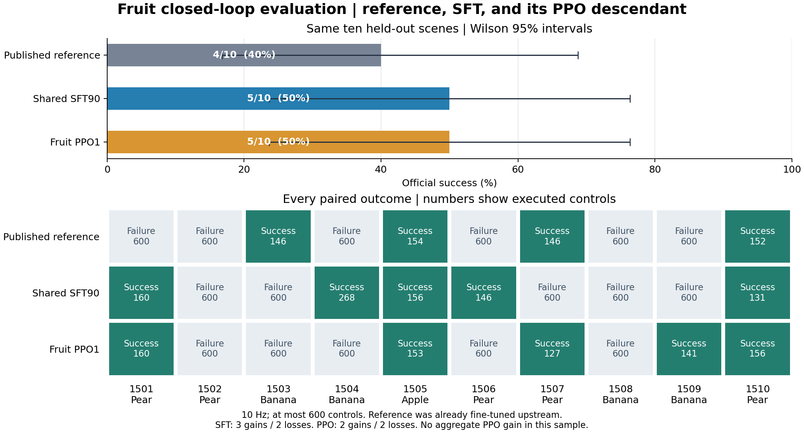

# Fruit SFT and PPO experiment

The fruit experiment ran on November 22-23, 2026 (Asia/Shanghai). It connects expert data, LeRobot export, shared fruit/flower SFT, a zero-update RL handoff, one PPO iteration and paired autonomous evaluation. PPO did not improve aggregate success and its language results regressed.

## Checkpoint and interface

| Item | Frozen setting |
| --- | --- |
| Reference | Published VLABench pi05 Primitive, already fine-tuned upstream |
| Reference revision | `f658a8bec801aab960fe0ceab370a123b31c1837` |
| SFT parent | Shared `two-task-conservative-90`; 64 episodes / 9,904 frames; 90 updates |
| SFT SHA-256 | `998181bb8cc8386766aa5bec3302b938234ab5da2a24e81cef199a8fd560eef3` |
| PPO SHA-256 | `0d2fac4c03db18ceac98c2344aec358713251e3b37cbcfa154349392c4ca0ad3` |
| Normalization SHA-256 | `bce33fc1831830d953ef9bc57e520c02ee44e02b7ad07f27ce92b931a879384f` |
| Environment | Official VLABench Franka, MuJoCo, task scoring and controller; MSAA disabled |
| Inputs | Forward/right/wrist RGB and literal instruction; measured state supports the shared pose decoder; `discrete_state_input=False` |
| Execution | 10 Hz; predict ten actions, execute five; maximum 600 controls |

The shared SFT uses 47 fruit and 17 flower training episodes, plus five separate validation episodes / 744 frames. Its development scores were fruit 3/4 and flower 0/4. Flower did not pass the shared-policy completion gate and remains unfinished. No single-demonstration diagnostic checkpoint initializes PPO. [Data and development checks](../pose-robustness-v2/README.md)

[Training, handoff, PPO and evaluation commands](../../../single-gpu.md) use the same model/controller interface. The eleven registered source/configuration files remain at their original repository paths with their recorded hashes. [Registration](registration.json) and [upstream revisions](../../../upstream.md) identify the implementation.

## PPO and handoff

Three observation windows passed the fresh zero-update loading check with exactly equal normalized predictions, decoded actions and recomputed log probabilities. A new development-1201 rollout reproduced the parent's successful 135-control trajectory and full action hash. [Handoff record](handoff.json)

The frozen PPO recipe uses starts 1301 and 1302, one iteration, actor learning rate `2e-6`, critic learning rate `1e-4`, and flow-SDE noise 0.25. Rewards combine official success with declared geometry-progress shaping. Target geometry, reward and success labels are excluded from policy inputs. [PPO configuration](../../../../configs/ppo-fruit-completion-v1.json) and [reward review](../../../fruit-reward-review.md)

PPO consumed **731 controls, 147 action chunks and 19 optimizer steps**, with one successful training rollout. Sampling and recomputed log probabilities differed by at most `3.8147e-6`. The saved-weight audit confirmed changes to **216 action-expert LoRA tensors and eight action-head tensors**, separately from eight critic tensors. This demonstrates an actual VLA actor update.

The rollout/update loop took 232.5 seconds and peaked at 7.33 GB allocated CUDA memory on the instance reporting an RTX 4080 SUPER. Initialization and evaluation are additional costs; this is one bounded iteration rather than a convergence claim. [Update evidence](ppo/iteration-1.json), [training rollouts](ppo/rollouts.jsonl) and [saved-checkpoint audit](saved-checkpoint-update-audit.json)

## Development comparison

| Seed | Target | Reference | Shared SFT90 | Fruit PPO1 |
| --- | --- | --- | --- | --- |
| 1201 | Banana | Success / 120 controls | Success / 135 | Success / 174 |
| 1202 | Pear | Success / 136 | Success / 149 | Success / 179 |
| 1203 | Orange | Failure / 600 | Failure / 600 | Failure / 600 |
| 1204 | Pear | Failure / 600 | Success / 125 | Success / 123 |
| Total | | 2/4 | 3/4 | 3/4 |

Development informed checkpoint selection and is separate from the final tests. The failed orange case had 164, 139 and 280 nonconverged IK controls respectively; those counts do not identify a unique training cause. [Paired development report](development-comparison.json)

## Ten held-out fruit scenes

The numerical seeds 1501-1510 were fixed before inspecting their outcomes. All policies share resets, policy images, prompts, normalization, sampler and execution budget. The [reference reuse audit](reference-reuse.json) checks existing records against the frozen manifests and four exact fresh repeats. All [twenty original reference records](reference-original-20.jsonl) remain available; the numerical first ten define this comparison.

| Policy | Official successes | Success rate | Wilson 95% interval | Controls |
| --- | ---: | ---: | ---: | ---: |
| Published reference | 4/10 | 40% | 16.8-68.7% | 4,198 |
| Shared SFT90 | 5/10 | 50% | 23.7-76.3% | 3,861 |
| Fruit PPO1 | 5/10 | 50% | 23.7-76.3% | 3,737 |

SFT gained three reference failures and lost two reference successes. PPO gained two SFT failures and lost two SFT successes. Its aggregate success stayed unchanged. All failed ordinary rollouts moved the target without satisfying the official goal within budget. Ten starts and overlapping intervals do not establish a reliable improvement. [Every paired outcome and failure type](ordinary-comparison.json)



## Paired language tests

Three scenes, seeds 1601-1603, retain identical initial physics and policy RGB while changing only the instruction. Official targets are pear/orange/pear; alternate targets are lemon/lemon/banana. Paraphrases use the same original target.

| Prompt group | Reference | Shared SFT90 | Fruit PPO1 |
| --- | ---: | ---: | ---: |
| Official | 1/3 | 1/3 | 0/3 |
| Paraphrase | 0/3 | 1/3 | 0/3 |
| Different target | 1/3 | 1/3 | 1/3 |

The three groups reuse the same scenes and cannot be pooled as nine independent scenes. Each 1/3 has Wilson 95% interval 6.1-79.2%; 0/3 has interval 0.0-56.1%. PPO lost the SFT official and paraphrase successes. Actions changed with the prompts in every stage, but no policy completed both targets in the same scene. This does not establish correct language use. [All prompts, raw outcomes and comparisons](comparison.json)

## Videos and training curves

Scene 1501 asks for the pear. The reference failed after 600 controls; SFT and PPO succeeded after 160. All three recordings matched the scored initialization, policy inputs, complete action hash, official outcome and IK count. MP4 timing is 10 Hz; GIF previews run at twice the speed. Display mosaics are 1024 pixels; policy images retain their scored resolution.

[Reference video](../../../../media/policy/fruit-completion-v1-base-1501.mp4?raw=true), [SFT video](../../../../media/policy/fruit-completion-v1-sft-1501.mp4?raw=true), [PPO video](../../../../media/policy/fruit-completion-v1-ppo-1501.mp4?raw=true), [video verification](local-video-verification.json)

[Training and motion analysis](../../2026-11-23/training-and-motion/README.md) shows all 90 SFT losses and the aligned control traces. No PPO actor/critic loss history was logged, so no PPO convergence curve is claimed.

## Reproduce the saved-evidence checks

```bash
python scripts/review_fruit_experiment.py
```

The [public evidence manifest](public-evidence.json) retains 45 original files: all 57 final ordinary/language episode records, development comparisons, reset manifests, SFT/PPO records, video plans, control traces and final videos. Their bytes and hashes match the [original 201-file export manifest](evidence-export.json). The [SFT summary](sft-parent/summary.json), [complete update log](sft-parent/updates.jsonl) and [split isolation audit](split-isolation.json) remain available.

The current source release omits scheduling logs, process IDs, duplicate per-case records, duplicate source/configuration snapshots and superseded diagnostics. This is a packaging change: all scored successes and failures are retained. The manifest records the prior full-export Git commit. Weights, source datasets, assets and credentials remain outside Git. CPU verification rechecks saved records; it does not rerun the simulator or load original checkpoints.
