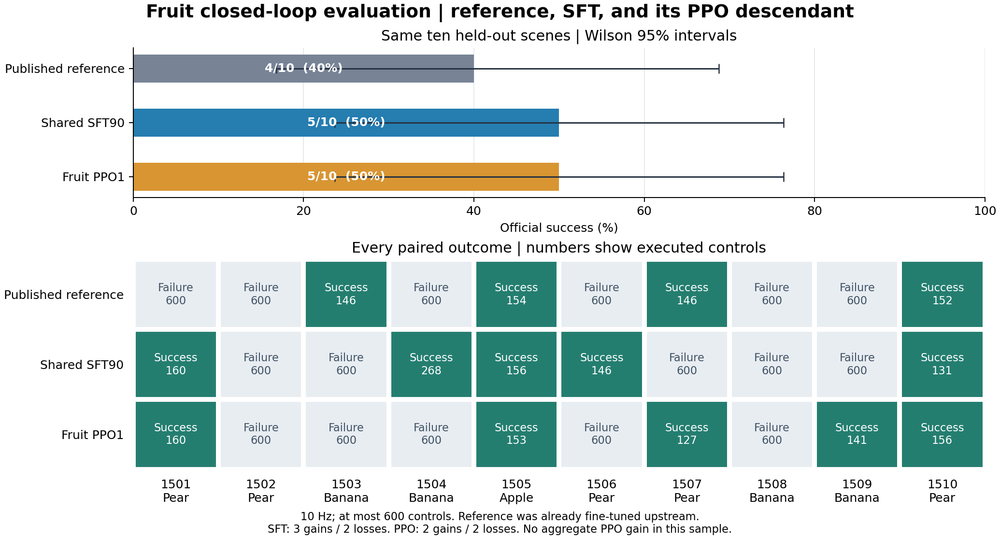
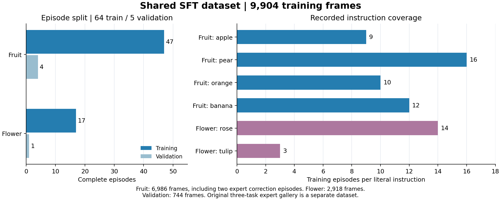

# 📊 Project overview figures and CPU verification

Generated on November 23, 2026 from the frozen fruit-completion-v1 evidence and the existing pose-dataset contract audit. These figures organize completed measurements; they do not add a model run or change the reported outcomes.

## Paired closed-loop outcomes



The upper panel shows official success and Wilson 95% intervals for the same ten held-out scenes. The lower panel retains every scene and its executed control count. SFT changes three reference failures to success and loses two reference successes. PPO changes two SFT failures to success and loses two SFT successes. The aggregate counts are 4/10, 5/10, and 5/10; no overall PPO success gain is established. The reference is already fine-tuned upstream.

## Dataset coverage



The plot uses the exact SFT parent's 64 training and five validation task/seed pairs. Training instruction counts and frame counts come from the completed transform/controller audit. The 47 fruit episodes include two expert corrections; all 17 flower episodes are expert demonstrations. The original three-task gallery is a separate dataset.

## Verify without a GPU

From a clone of the repository, Python 3.9 or newer is sufficient for this command. No simulator, model weights, or third-party package is loaded:

```bash
python scripts/review_fruit_experiment.py
```

The command was run successfully with Windows Python 3.9.13 and WSL Python 3.10.12. Its output is:

```text
Verified 201 evidence files and 11 registered source/config hashes.
Published reference: 4/10 successes, 40%, 4198 controls
Shared SFT90: 5/10 successes, 50%, 3861 controls
Fruit PPO1: 5/10 successes, 50%, 3737 controls
Actor update: 224 changed tensors; 19 PPO optimizer steps; 731 environment controls.
Checks use saved evidence only; no GPU, weights, or simulation are required.
```

It rehashes exported evidence, checks the registered source/configuration files, recomputes 57 ordinary/language episode outcomes, checks paired input fields and checkpoint identities, and compares saved actor-update evidence with the training record. Registered text files may be normalized from CRLF to LF for cross-platform checkout compatibility; raw evidence is hashed without newline conversion. It rejects missing or changed evidence and inconsistent scores. Original weight tensors and source datasets are excluded from Git, so this review checks their exported audit records rather than rerunning those audits.

To save a machine-readable report, choose a new output directory:

```bash
python scripts/review_fruit_experiment.py --output .local/fruit-review
```

To regenerate the scientific figures in the existing WSL project environment with NumPy and Matplotlib:

```bash
PYTHONDONTWRITEBYTECODE=1 MPLCONFIGDIR=.local/matplotlib \
  /var/tmp/pi05-vlabench-1000/venv/bin/python scripts/review_fruit_experiment.py \
  --figures --output .local/project-overview-rerun
```

The first figure generation used this report directory as the output. The plotting script refuses to overwrite an existing output. [Report, measurements, input hashes, and figure hashes](report.json) · [Reviewer source](../../../../scripts/review_fruit_experiment.py) · [Frozen experiment](../../2026-11-22/fruit-completion-v1/README.md)
