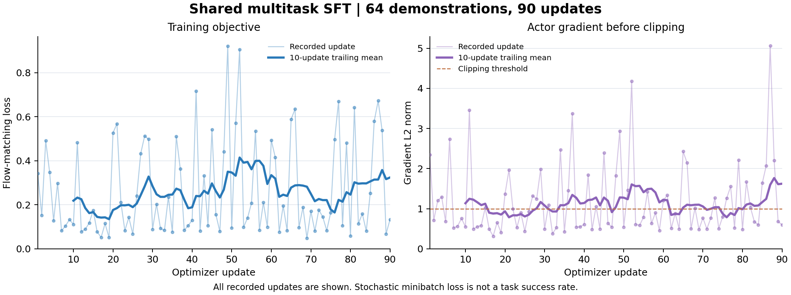
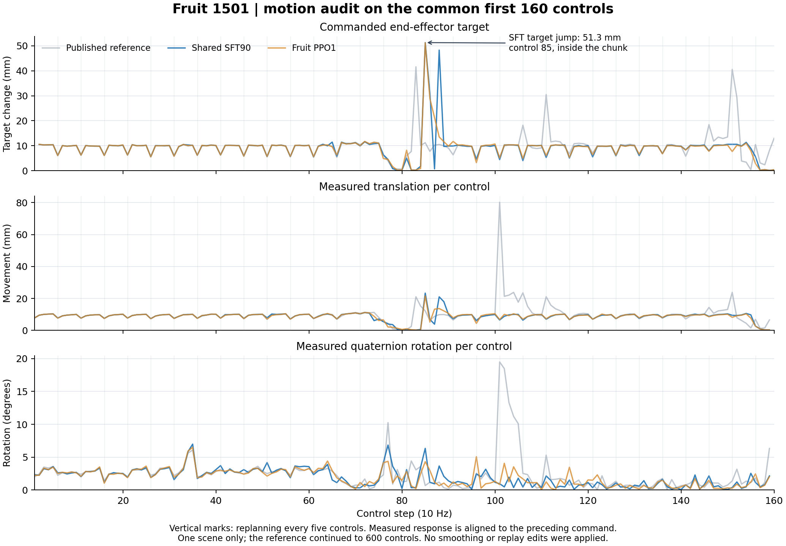

# 📈 Training signals and motion analysis

Analysis of the saved fruit-completion-v1 logs on November 23, 2026. The figures use the completed experiment's training records and recorded control traces. No model was loaded, trained, or rerun to produce them.

## SFT training



The shared policy used 64 complete fruit/flower demonstrations, 9,904 training frames, and 90 optimizer updates. Every recorded flow-matching loss and gradient is shown; the heavier line is a trailing mean over ten updates. Each optimizer update accumulated two microbatches of four samples. The logged gradient norm is the value returned before clipping at 1.0.

| Training signal | Value |
| --- | ---: |
| First / last update loss | 0.34246 / 0.13381 |
| First ten / last ten update mean loss | 0.21896 / 0.32430 |
| Minimum / maximum loss | 0.04866 / 0.92125 |
| Maximum gradient norm before clipping | 5.05849 |

The last individual loss is lower than the first, but the full series has no sustained downward trend. Changing sampled frames, tasks, flow noise, and flow times affect this stochastic objective; it is not a fixed evaluation batch or a task success rate. The available records do not isolate which factor explains the variation. The per-row `task` field names the last sampled episode and must not be treated as the task for the whole accumulated batch.

Validation action error was measured before and after training; a validation loss history was not recorded. The completed PPO run records rollout rewards, actor gradients, parameter changes, and optimizer step counts, but has no per-step actor loss, critic loss, or KL history. A PPO convergence curve cannot be reconstructed from those records. See the [original SFT log](../../2026-11-22/fruit-completion-v1/sft-parent/updates.jsonl), [training summary](../../2026-11-22/fruit-completion-v1/sft-parent/summary.json), and [PPO update evidence](../../2026-11-22/fruit-completion-v1/ppo/iteration-1.json).

## Motion in the recorded pear scene



All stages use scene 1501 at 10 Hz with a ten-action prediction horizon and five executed controls per prediction. The chart compares their common first 160 controls. SFT and PPO finish successfully at control 160; the reference continues to the 600-control limit. Each faint vertical line marks a new prediction.

| Common first 160 controls | Reference | SFT90 | PPO1 |
| --- | ---: | ---: | ---: |
| Largest change in commanded XYZ target | 41.59 mm | 51.30 mm | 51.23 mm |
| Largest measured translation per control | 80.20 mm | 23.33 mm | 21.56 mm |
| Largest measured rotation per control | 19.49° | 6.99° | 6.50° |
| Nonconverged IK controls | 0 | 0 | 0 |

The SFT target jumps 51.30 mm at control 85, inside a predicted chunk. It drops back at control 86 and rises again at control 88. This occurs during the grasp-to-lift transition, while the trace reports the target grasped. The discontinuity is present in commands and in physical response, so playback alone does not explain the abrupt motion. SFT's mean target change is 7.09 mm at replanning boundaries and 9.89 mm inside chunks; a boundary-only explanation is insufficient.

The complete SFT and PPO rollouts each have zero IK failures and only two gripper command switches. The reference has 206 IK failures over its complete 600-control rollout; that longer total is separate from the matched-prefix table. These measurements do not establish one cause of motion irregularity across all scenes.

### Timing and orientation

The trace logs measured pose **before** each control. The change from row `t` to row `t+1` is therefore plotted as the response to control `t`. Command changes are plotted at the control where the new command is issued. With 160 pre-control poses, there are 159 measured response intervals; the terminal response after control 160 is unavailable.

Rotation uses `2 * acos(abs(dot(q_t, q_t+1)))` on normalized measured quaternions. Raw Euler coordinates can cross an angle wrap without a comparable physical rotation. Their raw vector differences are retained in [analysis.json](analysis.json) only as a coordinate diagnostic.

### What to check next

The inference code samples new flow noise at each prediction and executes chunks without explicit cross-chunk blending. [ACT, Section IV-A](https://arxiv.org/html/2304.13705v1#S4.SS1) combines predictions for the same execution time through temporal ensembling. [Real-Time Chunking, Sections 2–3](https://arxiv.org/html/2506.07339v2) addresses flow-policy continuity through overlapping generation and inpainting. These are candidate execution methods to test, not verified fixes for this trace; the observed within-chunk jump requires its own check.

A focused motion experiment should first log raw predicted chunks and decoded targets around controls 80–90, then compare them with the expert lift targets. Use the same checkpoint and sampler for that diagnostic. A later smoothing experiment must keep the official controller, record the changed policy execution rule, and receive a fresh closed-loop evaluation. Smoothing a video would not validate the policy.

The MP4s preserve 10 Hz timing; GIF previews play at twice the speed. Low frame rate and accelerated previews can exaggerate the appearance, but do not remove the measured discontinuities. The saved logs contain no simulator substep, joint velocity, or inference latency history, so those causes cannot be resolved here.

## Reproduce the figures

Run from the repository root in the existing project environment with NumPy and Matplotlib. Choose a new output directory: the script refuses to overwrite an existing report.

```bash
PYTHONDONTWRITEBYTECODE=1 MPLCONFIGDIR=.local/matplotlib \
  /var/tmp/pi05-vlabench-1000/venv/bin/python scripts/analyze_training_and_motion.py \
  --experiment docs/experiments/2026-11-22/fruit-completion-v1 \
  --output .local/training-and-motion-rerun
```

This command was run under Ubuntu 22.04 / WSL2 with Python 3.10.12, NumPy 1.25.0, and Matplotlib 3.10.9; the first output destination was this report directory. [Machine-readable measurements, input hashes, and figure hashes](analysis.json) · [Analysis script](../../../../scripts/analyze_training_and_motion.py) · [Frozen experiment and videos](../../2026-11-22/fruit-completion-v1/README.md)
