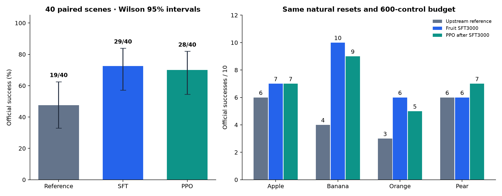
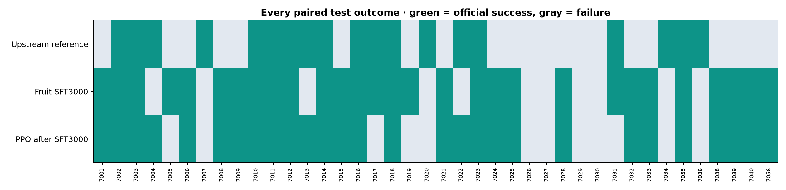
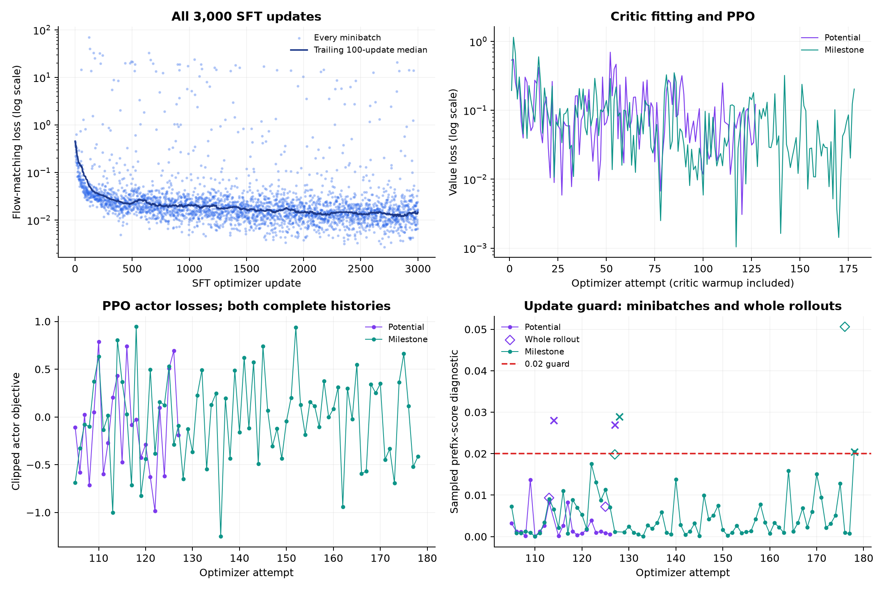

# 🍎 Fruit full-action SFT and PPO

**English** | [简体中文](README.zh-CN.md)

This experiment trains π0.5 on **47 replay-verified fruit episodes / 6,986 frames**, then updates the same action policy with PPO. The vision-language backbone stays frozen. Both stages train the full action expert and action/time heads: **430,098,464 parameters**.

## 📊 Paired closed-loop results

Forty reserved natural resets, ten each for apple, banana, orange and pear. Every model sees the same initial physics, policy images and literal instruction, with the same official Franka controller, 10 Hz control, ten predicted actions, five executed controls and 600-control limit.

| Policy | Official successes | Success rate | Wilson 95% interval |
| --- | ---: | ---: | ---: |
| Upstream VLABench reference | 19/40 | 47.5% | 32.9–62.5% |
| Fruit full-action SFT3000 | 29/40 | 72.5% | 57.2–83.9% |
| PPO from the same SFT3000 | 28/40 | 70% | 54.6–81.9% |

The reference is an upstream **VLABench-finetuned** π0.5 model. It uses its original normalization; the SFT and PPO models share separately fitted, training-only action statistics. Official success checks the fruit inside the plate region and does not additionally require released, settled placement.





The exact paired PPO-versus-SFT test gained 3 scenes and lost 4 (two-sided exact McNemar p=1). Counts describe this fixed suite; one RL training seed and forty test scenes give limited evidence about broader performance.

## 📈 Training and reward comparison



SFT uses 3,000 optimizer updates, microbatch two × accumulation four, learning rate `1e-5`, continuous shortest-Euler labels and FP32 master AdamW. All 47 training episodes are sampled. Four separate validation episodes contain 589 frames. Images and language follow the published input profile; measured state supports the shared pose decoder. Reward geometry and success labels stay outside policy observations.

The two PPO arms begin from the **same exact SFT checkpoint**, use training starts 1302, 1308, 1303 and 1301, actor learning rate `1e-6`, critic learning rate `1e-4`, and a `0.02` sampled executed-prefix score guard:

| Arm | Reward |
| --- | --- |
| Potential | Official success + `0.5 × (0.99 × Phi(next) − Phi(now))`; effective next potential zero at every task terminal |
| Milestone | +0.2 once for the correct grasp sustained above 4 cm for three controls; +0.8 once on official success |

Milestones change the objective; the project makes no policy-invariance claim for that reward. Critic warmup leaves actor tensors exactly unchanged. PPO then collects fresh on-policy trajectories. Sampling/replay log probabilities cover only the controls actually executed, including partial final chunks. The score guard measures the selected flow transition's executed prefix, rather than analytic full-chain or decoded-action KL.

All valid saved candidates were screened on the same four development scenes. The fixed rule selected **potential, iteration 2**; the selected candidate scored **11/16** after extension to all development scenes. Model identities were locked before any reserved-test inference. The new SFT's 9/16 tied the retained SFT180; the original strict upgrade gate failed. A prospectively recorded amendment allowed this bounded reward study from the tied parent after its repeated seen-reset and zero-update handoff checks passed.

Milestone iteration two exceeded the whole-rollout score guard (`0.05061 > 0.02`) and was rejected before saving. Its interactions and updates remain in the logs and cost totals. Three valid saved candidates were eligible; no threshold was relaxed. [Recorded training outcome](evidence/training-outcome.json)

## 🔍 Compatibility and actual VLA updates

- Three recorded observation windows have identical normalized predictions and shared decoded actions across the SFT and zero-update RL interfaces.
- All **16 development rollouts** preserve their full action hashes and outcomes before any RL update. [Handoff evidence](evidence/handoff/development.json)
- The selected checkpoint retains **21 actual actor optimizer steps**, with gradients and changes to the full action expert and heads independently checked from saved tensors. [Saved actor audit](evidence/potential/saved-actor-audit.json)
- The multi-episode SFT passes three fresh resets of its seen seed 42. These deterministic repeats establish execution repeatability on one training initialization, rather than held-out success accuracy.

The full reward comparison used **5,884 environment controls**, including critic warmup and the rejected final iteration. SFT training took 64.1 minutes; both PPO arms together took 29.5 minutes. These are measured training wall times; development evaluation, final testing and video rendering are separate. The runtime reported an RTX 4080 SUPER with 32,760 MiB visible memory. [Environment record](evidence/environment-audit.json)

The SFT checkpoint retains optimizer/master state and supports training resume. PPO exports contain actor/critic weights and provenance only; they support inference and **do not support optimizer resume**. The saved-weight audit verifies actor tensor changes. Optimizer-step evidence for PPO comes from its recorded updates, because those checkpoints omit optimizer state.

## 🚀 Verify and reproduce

From this directory, Python 3.9+ can recompute all 120 outcomes and check exported hashes with the standard library:

```bash
python analyze.py --evidence evidence --output results --verify-only
```

To regenerate figures, run without `--verify-only` in an environment with NumPy and Matplotlib. The retained `implementation/sft/` and `implementation/rl/source/` directories contain the exact phase-specific sources. [Verified training and evaluation commands](commands.md)

The earlier [shared fruit/flower SFT180 comparison](../fruit-recovery-v2/README.md) used a different forty-scene manifest and remains a separate experiment. Learned-policy completion here covers fruit selection; flower and fridge videos elsewhere in the repository are expert demonstrations.
