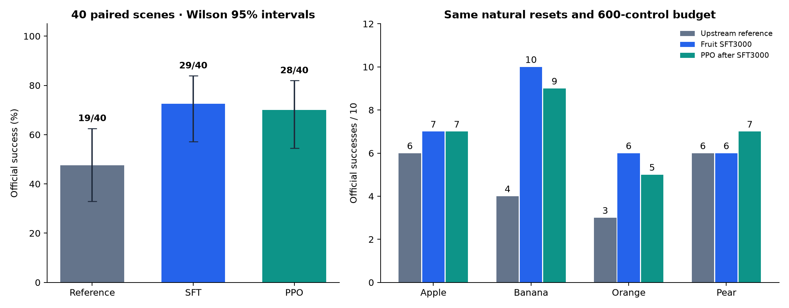
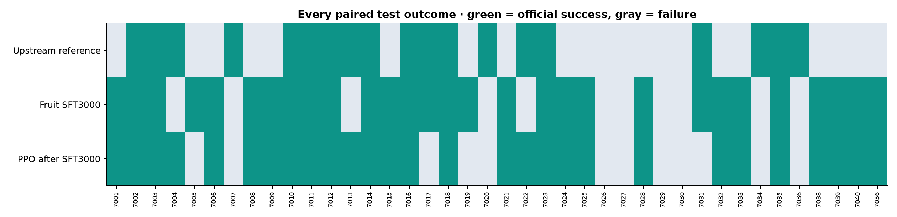
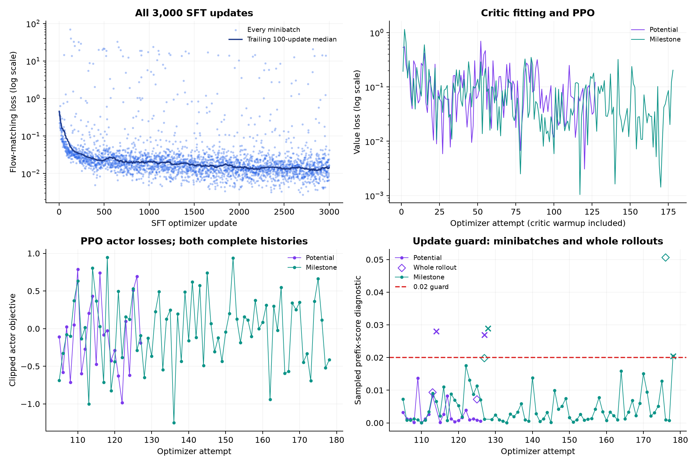

# 🍎 水果任务完整动作专家 SFT 与 PPO

[English](README.md) | **简体中文**

本轮使用 **47 条通过动作回放验证的水果轨迹，共 6,986 帧**，先做 π0.5 监督微调，再从同一份 SFT 权重做 PPO。视觉语言骨干冻结，训练完整动作专家和动作头，共 430,098,464 个参数。

## 📊 同条件闭环评测

预留 40 个自然初始化场景，苹果、香蕉、橙子、梨各 10 个。三组模型使用相同起点、策略图像、语言指令、官方 Franka 控制器与执行预算：10 Hz，每次预测 10 步、执行 5 步，最多 600 次控制。

| 模型 | 官方成功数 | 成功率 | Wilson 95% 置信区间 |
| --- | ---: | ---: | ---: |
| Upstream VLABench reference | 19/40 | 47.5% | 32.9–62.5% |
| Fruit full-action SFT3000 | 29/40 | 72.5% | 57.2–83.9% |
| PPO from the same SFT3000 | 28/40 | 70% | 54.6–81.9% |

参考模型已经由上游在 VLABench 微调，并非未经训练的基础模型；参考模型保留原始归一化，SFT/PPO 共用仅从训练集拟合的动作归一化。官方成功条件检查目标水果进入盘子区域，不额外要求松爪后稳定放置。





PPO 相对 SFT 新增成功 3 个场景，同时丢失 4 个。完整配对统计、失败类型和置信区间保存在 [comparison.json](results/comparison.json)。单个 RL 训练随机种子和 40 个测试场景仍不足以证明广泛泛化。

## 📈 训练与奖励



SFT 共 3,000 次更新，微批次 2、梯度累积 4、学习率 `1e-5`，使用连续最短欧拉角标签及 FP32 主参数优化。验证集单独保留 4 条轨迹、589 帧。模型输入使用规定的图像和指令，实测机器人状态用于动作解码；奖励几何真值与成功标签不进入策略输入。

两组 PPO 从同一份 SFT 权重开始，训练初始化、采样种子、控制接口和学习率相同。距离势函数组使用折扣一致、终止势函数归零的奖励；分阶段组对正确抓取并持续抬高 4 cm、保持 3 次控制奖励 0.2，达到官方成功再奖励 0.8。每个事件只支付一次。分阶段奖励改变优化目标，不宣称策略不变性。

开发集初筛选中 **potential 第 2 轮**，补齐开发集后为 **11/16**。测试前已固定模型。分阶段奖励第二轮整批更新幅度超过阈值，按规则拒绝保存；其交互成本仍计入总数，没有放宽阈值。

## 🔍 接口与参数检查

SFT 加载进 RL、尚未更新时，16 个开发场景的全部动作哈希和结果逐条一致。实际保存的 PPO 动作专家与动作头均发生参数变化，选中权重累计保留 **21 次真实策略更新**。两组奖励实验合计使用 **5,884 次环境控制**，包含 critic 预热与被拒绝轮次。

同一起点 42 的三次自主重置成功用于确认训练样本的可重复执行，不作为泛化准确率。本轮 SFT 在开发集为 9/16，与旧 SFT180 持平，未通过原先严格提升门槛；PPO 奖励研究使用了训练前记录的补充协议。详细条件、源代码、成本及限制见 [英文记录](README.md)。

## 🚀 核验

在当前目录执行：

```bash
python analyze.py --evidence evidence --output results --verify-only
```

该命令仅用 Python 标准库核对导出文件和 120 条测试结果；去掉 `--verify-only` 可在已有 NumPy/Matplotlib 环境重画图表。训练命令见 [commands.md](commands.md)。SFT 权重可恢复优化器，PPO 导出权重仅支持推理，不包含优化器恢复状态。权重、数据、资产与环境不提交到仓库。

本轮完成学习策略闭环的是水果任务；仓库中插花和冰箱视频属于专家演示，不能作为学习策略成功案例。早期 SFT180 的 40 场景测试使用另一份测试清单，保留为独立历史记录。
