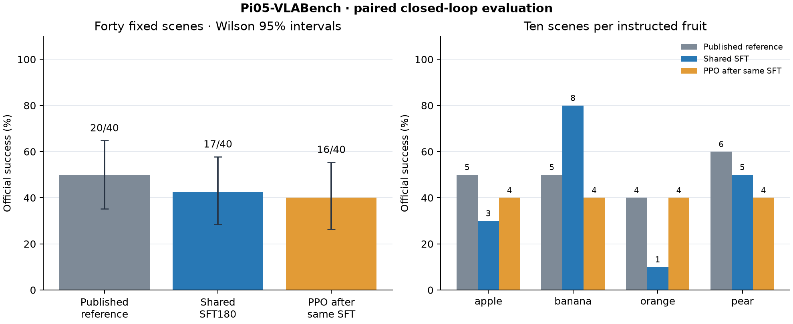
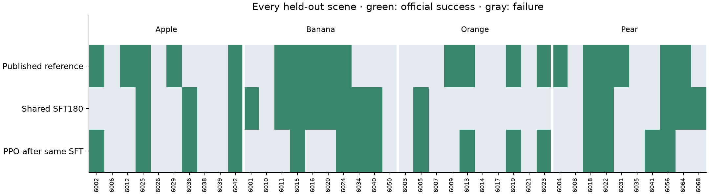
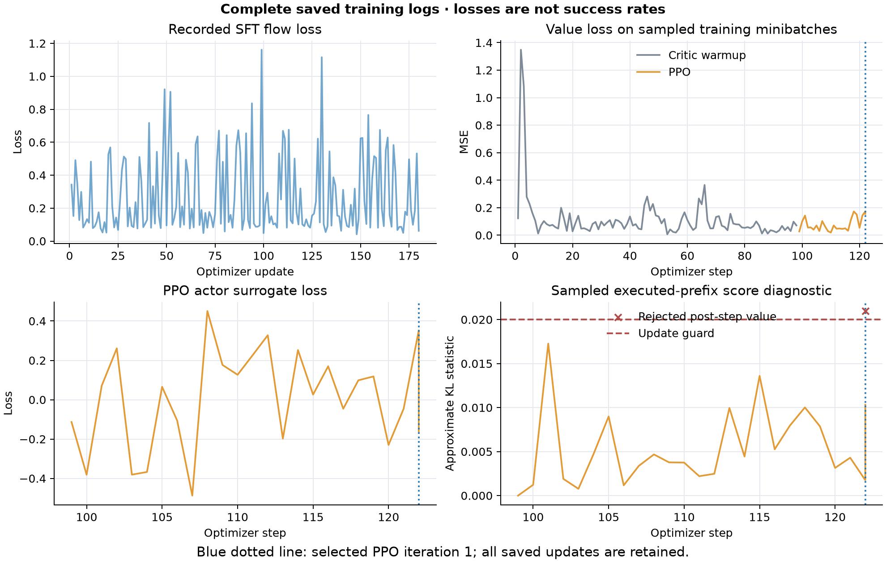
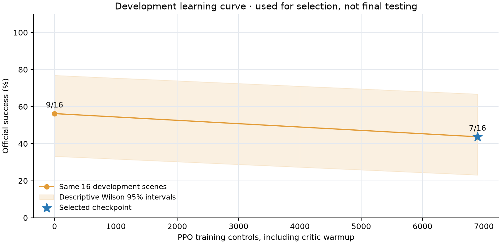

# 🍊 Fruit reward and coverage study

This follow-up separates SFT checkpoint selection, reward validation, and a fresh balanced test. It preserves the [November 22 experiment](../../2026-11-22/fruit-completion-v1/README.md). Reference/SFT test outcomes remained sealed until the PPO checkpoint identity was frozen on development. [Executed commands](commands.md)

## 🔍 Completed checks

- After the instance clone, SFT90 reproduced its saved zero-update RL handoff and complete seed-1201 action hash.
- Continuing the same SFT recipe to 360 updates saved checkpoints at 180 and 270. The original four-scene screen gave 2/4 at 180 and 1/4 at 360. This screen chose the 180-update candidate for a larger development comparison.
- On sixteen development scenes, SFT90 scored **8/16** and SFT180 scored **9/16**. The rule required a strict increase in successes; ties would retain SFT90. SFT180 was selected without consulting new test outcomes.
- SFT180 then passed its own zero-update RL handoff: three real observation windows had exactly matching normalized and decoded predictions, and one complete successful rollout reproduced the SFT action hash.

The selected SFT SHA-256 is `695378ced44c199107772e69df7b9904f6c1636b0bb4cc273afb2b1e0bb625e7`. Its normalization is unchanged: `bce33fc1831830d953ef9bc57e520c02ee44e02b7ad07f27ce92b931a879384f`.

## 🧪 Reward smoke experiment

Both reward variants started from **SFT90**, with the same two training starts, sampler seed, learning rates, two critic-warmup epochs, and one PPO iteration. Each used **1,032 controls**, including warmup, and applied eight actor optimizer steps. Both saved a checkpoint.

For the corrected potential reward, critic MSE on the warmup data decreased from 0.59479 to 0.03539. Actor parameters stayed exactly unchanged during warmup. During PPO, all 216 action-expert LoRA tensors and eight action-head tensors changed. The final sampled executed-prefix score diagnostic was 0.00360, below the 0.02 update guard. These are optimization checks; the two successful pre-update training rollouts are not a post-training success-rate result.

The corrected-reward checkpoint scored **5/16** on development, below its SFT90 parent at 8/16. The legacy-reward checkpoint scored **10/16**. These development outcomes were used for model selection; they are not fresh final-test results. [Reward definitions and references](../../../fruit-reward-review.md)

The expanded run uses the **selected SFT180 parent** and eight starts with two naturally reset targets per fruit. It is a separate comparison from the two-start SFT90 smoke experiment. The speculative corrected-reward expansion was stopped before actor updates after the paired smoke comparison preferred legacy; it used 3,868 completed warmup controls and is not a trained VLA result.

The legacy expansion completed critic warmup and one actor iteration. On the same sixteen development scenes, the saved PPO checkpoint scored **7/16**, below SFT180's 9/16. The planned second iteration stopped during fresh rollout collection, before applying another actor update. MuJoCo reported `mjWARN_BADQACC` at the banana object's joint in seed 1314, control 335. All sampled pose actions were finite; the instructed fruit had already left the table. This identifies numerical simulator instability, but does not isolate the contact or asset defect that triggered it. The incomplete batch was not used for training. [Stop record](evidence/ppo/run-stop.json)

The single valid checkpoint was frozen under the registered development rule before opening the reference/SFT test outcomes. No later checkpoint or three-iteration completion is claimed. [Frozen selection](evidence/final-selection.json)

## 🧮 Actor update and cost

Critic warmup used **3,868 controls** and reduced its sampled return MSE from 0.09616 to 0.04659. It left actor parameters exactly unchanged. The subsequent fresh on-policy collection added **3,029 controls**. PPO applied **24 actor steps**, changing 216 action-expert LoRA tensors and eight action-head tensors. The saved optimizer has 24 actor steps and 122 critic steps, including 98 warmup steps. The final executed-prefix score diagnostic was 0.00684, below the 0.02 guard.

The selected checkpoint therefore used **6,897 training controls**. The full attempted legacy expansion used **10,078 completed controls plus one failed control attempt**; later partial collection is compute cost, not an additional trained checkpoint. The first saved iteration's rollout/update clock was 2,388.7 seconds, excluding model loading, evaluation, recording, and earlier studies. Its training process recorded a peak CUDA allocation of 7,472,764,416 bytes. Other evaluations shared the device, so this is not an isolated throughput benchmark or total device memory usage.

Both reward smoke runs together used 2,064 controls; the stopped corrected expansion used 3,868 complete controls. These extra preparation costs are separate from the selected checkpoint's training budget. No monetary cost was recorded. [PPO report](evidence/ppo/iteration-1.json) · [Warmup](evidence/ppo/warmup.json) · [Complete rollout log](evidence/ppo/rollouts.jsonl)

## 🦾 Data and failure diagnosis

The SFT checkpoints still use 64 training episodes: 47 fruit and 17 flower. Four newly collected fruit episodes, two orange and two banana, passed successful fresh action replay and LeRobot v2.1 verification across all **603 frames**, including ten-action boundary checks. These four episodes have **not** been used to train the selected parent.

In SFT90's orange development failure, seed 1203, the first target contact occurred at control 76 with the gripper commanded open. The first close command came at control 77, when the post-control gripper-to-target distance was 86.7 mm. The first IK nonconvergence followed at control 86. The official expert completed that same initialization in 180 controls with no IK nonconvergence. This trace supports investigating approach and grasp timing before attributing the failure solely to reward or unreachable geometry.

## 📊 Reserved test

The new test contains forty complete scenes, ten targets each for apple, banana, orange and pear. Starts were selected from natural resets by target identity, without calling a policy or executing controls. Training, development and reserved-test initialization hashes are disjoint. The manifest SHA-256 is `5156c7f5bdd32e3405f7a7747969b0f2faa813c30e3f498ea0f70ffead21f36d`.

Reference, selected SFT, and PPO used identical scene manifests, literal instructions, camera inputs, normalization, 10 Hz official control, ten predicted actions, five executed actions and a 600-control budget. All 120 scored episodes completed. Reference/SFT outcomes were opened only after the PPO checkpoint identity was frozen.

| Policy | Official successes | Rate | Wilson 95% interval | Evaluation controls |
| --- | ---: | ---: | ---: | ---: |
| Published VLABench reference | 20/40 | 50% | 35.2–64.8% | 15,195 |
| Shared multitask SFT180 | 17/40 | 42.5% | 28.5–57.8% | 16,661 |
| PPO1 from the same SFT180 | 16/40 | 40% | 26.3–55.4% | 16,829 |

| Target, ten scenes each | Reference | SFT180 | PPO1 |
| --- | ---: | ---: | ---: |
| Apple | 5/10 | 3/10 | 4/10 |
| Banana | 5/10 | 8/10 | 4/10 |
| Orange | 4/10 | 1/10 | 4/10 |
| Pear | 6/10 | 5/10 | 4/10 |

SFT gained six scenes and lost nine relative to the reference (exact paired McNemar two-sided p = 0.607). PPO gained five scenes and lost six relative to SFT (p = 1.0). Neither comparison establishes an improvement. Per-target results are descriptive subsets of ten scenes, not evidence of a general fruit-specific gain.

The reference's twenty failures all moved the target but did not satisfy the goal. SFT had twenty such failures, two simulator instabilities and one case with target displacement below 3 cm. All twenty-four PPO failures moved the target without satisfying the goal. These automated categories describe trajectory outcomes; they do not identify one causal defect. The unchanged official success predicate uses the target fruit origin and the plate's containment region. It does not require releasing the fruit or waiting for a stable placement.

The [analysis entry point](analyze.py) checked all 120 raw results, rejects missing, repeated, mismatched or unpaired forty-scene outcomes, and verified that PPO descends from the evaluated SFT parent. An independent CPU load of the two saved checkpoints confirmed actor tensor changes and optimizer counters. The standard-library `--verify-only` command rechecks the exported records and recomputes the scores without downloading model weights. [Commands](commands.md) · [Raw comparison](results/comparison.json) · [Saved-weight audit](results/saved-checkpoint-audit.json)

## ⏱️ Training scope

SFT180 used an effective batch of eight and sampled 1,440 observation/action windows from 9,904 training frames. It is a short continuation of an upstream VLABench model, not training from scratch or evidence of convergence. The two-start reward comparison and one valid expanded PPO iteration are also preliminary. Forty evaluation scenes reduce the uncertainty of this measured result; they do not add training data or independent training seeds.

These forty test outcomes have now been inspected. Any later tuning must use development scenes for selection and a newly reserved test for an untouched final comparison. The current result supports a working, audited SFT-to-PPO implementation; it does not support a claim that either adaptation improved aggregate success.
