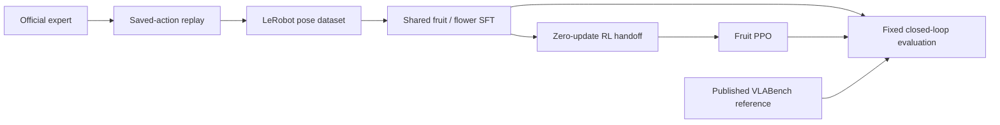
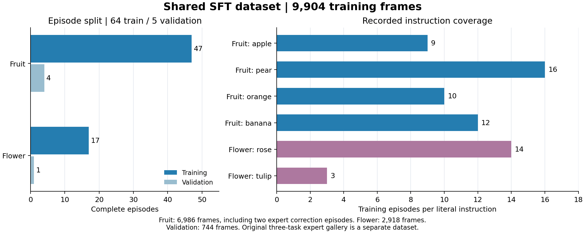

# 🧩 System design and implementation

The current result is a fruit-selection SFT-to-PPO experiment built from one shared fruit/flower policy. This page describes the executed pose-policy interface. The original joint-space pilot in [policy-io.md](policy-io.md) uses a different action representation and remains a separate historical experiment.

## Architecture



All rollout stages use the official VLABench Franka, MuJoCo tasks, inverse kinematics, and low-level control. The project adapts the data and learning interfaces around that controller.

## What this repository adds

| Work | Implementation | Checkable output |
| --- | --- | --- |
| Demonstration capture and real action replay | [select_fruit.py](../scripts/select_fruit.py), [collect_reference_fruit_pose_expert.py](../scripts/collect_reference_fruit_pose_expert.py) | Saved initialization, command trace, success, and fresh-simulator replay |
| Aligned pose dataset | [convert_lerobot.py](../scripts/convert_lerobot.py), [reference_pose_lerobot.py](../scripts/reference_pose_lerobot.py) | Episode/frame indices, timestamps, literal prompts, images, state/action arrays, and split verification |
| Multitask SFT | [train_reference_aligned_fruit.py](../scripts/train_reference_aligned_fruit.py) | Mixed-task sampling, flow-matching updates, LoRA/head training, checkpoint reload, and validation records |
| SFT-to-RL compatibility | [check_reference_rl_handoff.py](../scripts/check_reference_rl_handoff.py) | Equal seeded predictions and shared decoding at three real observation windows; one matched closed-loop rollout before any PPO update |
| PPO integration | [ppo_reference_aligned_fruit.py](../scripts/ppo_reference_aligned_fruit.py), [ppo_pi05.py](../scripts/ppo_pi05.py) | On-policy chunks, executed-length log probabilities, GAE, clipped policy objective, actor and critic updates |
| Paired evaluation | [evaluate_vlabench_reference.py](../scripts/evaluate_vlabench_reference.py), [summarize_fruit_completion.py](../scripts/summarize_fruit_completion.py) | Fixed starts and prompts; official success, intervals, failure labels, full action hashes |
| Lightweight review | [review_fruit_experiment.py](../scripts/review_fruit_experiment.py) | CPU-only integrity checks, recomputed scores, and figures from exported evidence |

VLABench supplies the robot, tasks, expert skills, assets, and controller. The pinned OpenPI fork supplies the published VLABench reference and its transforms. RLinf supplies the PyTorch π0.5 and flow-SDE policy implementation. This project does not introduce a new foundation model or PPO algorithm. [Revisions and licenses](upstream.md)

## Data card

| Split / task | Complete episodes | Frames |
| --- | ---: | ---: |
| Training: fruit | 47 | 6,986 |
| Training: flower | 17 | 2,918 |
| Training total | 64 | 9,904 |
| Validation: four fruit + one flower | 5 | 744 |

The 47 fruit training episodes include 45 expert demonstrations and two expert correction episodes. Flower contributes 17 expert demonstrations. Corrections retain their source labels; they are not described as untouched expert-only trajectories. The original three-task gallery contains a different 60-episode joint-space dataset and is not added to these totals.



Training instructions cover apple (9), pear (16), orange (10), banana (12), rose (14), and tulip (3) episodes. This distribution has limited target and language variety. It does not establish open-vocabulary generalization.

Each episode preserves its task, seed, initialization hash, instruction, original views, measured state, commanded action, success, and termination information. At 10 Hz, frame `t` observes the state before executing action `t`; each label window contains the next ten actions from the same episode. Final action padding repeats the episode's last action rather than entering another episode. The reader checks `timestamp = frame_index / 10`, finite seven-coordinate arrays, and prompt identity.

Training and validation are separated by complete task/seed pairs and initialization checks. The fruit experiment also audits test initialization and PPO-training separation. The CPU reviewer rechecks exported split-audit records; a full dataset check requires the excluded datasets. [Training contract and replay oracles](experiments/2026-11-22/pose-robustness-v2/training-contract-audit.json) · [Split audit](experiments/2026-11-22/fruit-completion-v1/split-isolation.json)

## Policy and control contract

| Boundary | Executed setting |
| --- | --- |
| Images | Forward, right, and wrist RGB, mapped through the pinned VLABench/OpenPI adapter |
| Language | Original task instruction; no target coordinate, reward, or success label is appended |
| State | Measured end-effector XYZ, Euler orientation, and gripper state for shared transforms and action decoding |
| Learned state conditioning | Upstream `discrete_state_input=False` is preserved; measured state is not advertised as an additional learned input |
| Action | Seven coordinates: XYZ in meters, Euler angles in radians, and gripper command |
| Coordinates | Upstream robot-frame conversion for policy I/O; shared decoding restores simulator targets |
| Normalization | The same recorded quantile statistics in SFT and RL; padded model dimensions follow the upstream transform |
| Chunk | Predict ten controls; execute five before reading new policy images |
| Controller | Official pose-to-IK-to-nine-actuator path at 10 Hz |
| Evaluation | Maximum 600 controls, official success/termination, fixed renderer and seeded evaluation sampler |

The simulator may expose target truth for expert planning, reward calculation, and diagnostics. The policy encoder accepts only its image keys, literal prompt, measured state, and training labels when computing supervised loss. That whitelist prevents reward-only geometry from becoming an observation.

## Model and optimizer card

| Item | SFT | PPO |
| --- | --- | --- |
| Parent | Published VLABench π0.5 Primitive, already fine-tuned upstream | Exact shared SFT90 checkpoint |
| Trainable policy | Rank-16 action-expert LoRA and action input/output/time heads | Same policy groups; a separate value head is added |
| Vision/language backbone | Frozen; VLM LoRA rank zero | Frozen |
| Learning rate | `1e-6` | Actor `2e-6`, critic `1e-4` |
| Batch / budget | Microbatch four × accumulation two; 90 updates, 720 sampled windows | Two training rollouts; 147 chunks; 19 optimizer steps in one iteration |
| Objective | Supervised flow matching over expert action chunks | PPO clipped surrogate + value regression; clip 0.2, gamma 0.99, GAE lambda 0.95 per chunk |
| Sampling | Seeded evaluation noise | Flow-SDE exploration for training; same paired evaluation sampler as SFT for scoring |

The PPO implementation retains the sampled denoising chain and recomputes its policy log probability for the controls actually executed. It does not apply a Gaussian likelihood directly to a recorded video. The maximum measured sampling/recomputation discrepancy during PPO was `3.8147e-6`. [Update implementation](../scripts/ppo_pi05.py) · [Frozen PPO configuration](../configs/ppo-fruit-completion-v1.json)

Checkpoint identity is part of the interface:

```text
Shared SFT90 SHA-256
998181bb8cc8386766aa5bec3302b938234ab5da2a24e81cef199a8fd560eef3

PPO1 SHA-256
0d2fac4c03db18ceac98c2344aec358713251e3b37cbcfa154349392c4ca0ad3
```

The saved-checkpoint audit measured changes to 216 action-expert LoRA tensors and eight action-head tensors, separately from eight critic tensors. This establishes policy training beyond rollout collection or critic-only optimization; it does not establish performance improvement. [Saved-weight audit record](experiments/2026-11-22/fruit-completion-v1/saved-checkpoint-update-audit.json)

## Evaluation and cost

Development seeds 1201–1204 informed checkpoint selection. Ordinary held-out seeds 1501–1510 and three language layouts 1601–1603 were frozen separately. Each language layout is reused for an official instruction, paraphrase, and changed target; they must not be pooled as nine independent physical scenes.

The ordinary sample gives reference 4/10, SFT 5/10, and PPO 5/10. PPO changes which scenes succeed, with two gains and two losses relative to SFT. Language tests regress after PPO. Detailed outcomes, controls, confidence intervals, and action hashes remain in the [experiment report](experiments/2026-11-22/fruit-completion-v1/README.md).

| Recorded loop cost | Measured value | Exclusions |
| --- | ---: | --- |
| 90-update SFT loop | 142.5 s | Model loading, dataset setup, validation, and earlier experiments |
| PPO rollout/update loop | 232.5 s | Initialization, final evaluation, videos, and earlier experiments |
| PPO interactions | 731 controls | Evaluation controls are separate |

These times come from the instance reporting `NVIDIA GeForce RTX 4080 SUPER`; they are not end-to-end project completion times or a 3090 benchmark. No currency cost was recorded. Exact allocated-memory measurements and provenance are retained in the [machine-readable overview](experiments/2026-11-23/project-overview/report.json).

## Current scope

| Requirement | Status and evidence |
| --- | --- |
| Official expert generation and actual action replay | Verified; three-task expert gallery and pose replay oracles |
| LeRobot data and one mixed-task SFT checkpoint | Verified for the 64-episode fruit/flower training split |
| Autonomous learned policy before/after SFT and PPO | Paired fruit evaluation completed |
| Same SFT checkpoint loaded into RL before updates | Verified at three observation windows and one closed-loop start |
| VLA actor parameters updated by PPO | Verified by gradients and saved parameter changes |
| Three skills reliably solved by one learned policy | Unfinished; flower development is 0/4 and fridge learned-policy completion is pending |
| PPO success improvement and robust language use | Not established in this pilot |
| Smooth learned motion | Command discontinuities measured; a fix still requires a new experiment |

The next useful measurements are a reward-only comparison from the same SFT parent, a separate action-continuity diagnosis, and renewed flower imitation checks. Any tuned method needs fresh held-out starts because the current test outcomes have already been inspected. [Reward proposal](fruit-reward-review.md) · [Motion analysis](experiments/2026-11-23/training-and-motion/README.md)
