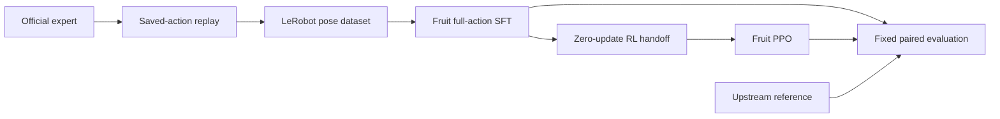

# 🧩 System design and implementation

The current learned-policy workflow is fruit selection: replay-verified expert episodes → full-action π0.5 SFT → zero-update RL handoff → PPO → paired autonomous evaluation. The latest [completed experiment](experiments/2026-11-24/fruit-full-action-v3/README.md) reports reference → SFT → PPO as **19/40 → 29/40 → 28/40**. Earlier shared fruit/flower checkpoints remain separate historical experiments.

## 🦾 Architecture and scope



VLABench provides the official Franka, MuJoCo tasks, expert skills, assets, inverse kinematics and low-level controller. The pinned OpenPI fork provides the VLABench reference and its transforms. RLinf provides the PyTorch π0.5 and flow-SDE policy. Repository work covers demonstration replay, data alignment, training integration, reward accounting, actor-update checks and evaluation. [Pinned revisions and licenses](upstream.md)

| Component | Executed implementation | Retained check |
| --- | --- | --- |
| Expert capture and action replay | [select_fruit.py](../scripts/select_fruit.py), [pose expert](../scripts/collect_reference_fruit_pose_expert.py) | Initialization, physical actions and official success in a fresh simulator |
| LeRobot conversion and reading | [converter](../scripts/convert_lerobot.py), [pose reader](../scripts/reference_pose_lerobot.py) | Episode indices, prompt/state/action alignment and initialization isolation |
| Current SFT | [Exact SFT source](experiments/2026-11-24/fruit-full-action-v3/implementation/sft/train_reference_aligned_fruit.py) | All 3,000 updates, FP32 master state and exact reload predictions |
| SFT-to-RL handoff | [Exact RL interface](experiments/2026-11-24/fruit-full-action-v3/implementation/rl/source/check_reference_rl_handoff.py) | Three real observation windows and all 16 complete development action hashes match |
| Current PPO | [Exact trainer](experiments/2026-11-24/fruit-full-action-v3/implementation/rl/source/train_fruit_ppo.py), [reward observer](experiments/2026-11-24/fruit-full-action-v3/implementation/rl/source/milestone_rollout.py) | Executed-prefix likelihood replay, actor gradients, saved tensor changes and update guards |
| Closed-loop evaluation | [Evaluator](experiments/2026-11-24/fruit-full-action-v3/implementation/rl/source/evaluate_pose_development.py) | Fixed scenes, official success, full action hashes and failure labels |
| CPU result review | [analyze.py](experiments/2026-11-24/fruit-full-action-v3/analyze.py) | All 120 test outcomes and exported source/evidence hashes |

The small phase-specific implementations retain the bytes actually used for training. Shared collection and simulator utilities stay under `scripts/`. [Commands and source-layout instructions](experiments/2026-11-24/fruit-full-action-v3/commands.md)

<a id="data-card"></a>

## 📦 Data card

| Split | Complete episodes | Frames |
| --- | ---: | ---: |
| Fruit training: 45 expert demonstrations + two expert corrections | 47 | 6,986 |
| Fruit validation | 4 | 589 |
| Development, used for diagnosis and candidate selection | 16 | Autonomous evaluation only |
| Reserved paired test, ten targets per fruit | 40 | Autonomous evaluation only |

Training covers apple (9), banana (12), orange (10) and pear (16) episodes. Validation, development, test and PPO-training starts are isolated by initialization hashes. The four PPO training starts are 1302, 1308, 1303 and 1301; their literal target instructions were checked before policy calls. [Data audit](experiments/2026-11-24/fruit-full-action-v3/evidence/sft/data-audit.json) · [PPO split audit](experiments/2026-11-24/fruit-full-action-v3/evidence/training-reset-audit.json)

At 10 Hz, frame `t` observes the state before action `t`. Each label window stays inside its complete episode and contains the next ten actions; final padding repeats the last action. Original instructions, images, measured state, action semantics, initialization and success/termination remain traceable. Expert target geometry, reward and success labels never enter policy observations.

The earlier shared policy used 47 fruit + 17 flower training episodes / 9,904 frames, and five validation episodes / 744 frames. The three-skill expert gallery is a separate joint-space dataset. Neither count is added to the current fruit training total. [Historical shared-policy report](experiments/2026-11-24/fruit-recovery-v2/README.md) · [Expert collection](stage2.md)

<a id="policy-and-control-contract"></a>

## 🎛️ Policy and control contract

| Boundary | Executed setting |
| --- | --- |
| Policy images | Forward, right and wrist RGB through the pinned OpenPI adapter |
| Language | Literal task instruction; no reward/target-coordinate annotations |
| State | Measured end-effector pose and gripper state for shared transforms and action decoding |
| Learned state conditioning | Upstream `discrete_state_input=False` is retained |
| Action | Seven coordinates: XYZ in meters, Euler orientation in radians, gripper command |
| Coordinates | Upstream robot-frame conversion and shared simulator pose decoding |
| Rotation labels | Continuous shortest-Euler differences |
| Normalization | Action quantiles fitted only on the 47 training episodes; original state statistics |
| Chunk | Predict ten; execute five controls before observing again |
| Controller | Official pose → IK → nine-actuator path at 10 Hz |
| Evaluation | Seeded sampler, fixed renderer, official success/termination and 600-control budget |

The upstream reference retains its original action normalization. Current SFT and PPO share their exact training-only normalization. Reward-only geometry is observed outside the policy encoder. Official success checks the fruit inside the plate region and does not separately require gripper release or settled placement. A successful rollout can end while the fruit is still held.

## 🧠 Model and optimizer card

| Item | Current SFT | Selected PPO |
| --- | --- | --- |
| Parent | Upstream VLABench-finetuned π0.5 Primitive | Exact SFT3000 weights |
| Trainable policy | Full action expert and action/time heads; 430,098,464 parameters | Same policy scope, plus separate critic |
| Vision/language backbone | Frozen, no VLM LoRA | Frozen |
| Policy learning rate | `1e-5` | `1e-6`; critic `1e-4` |
| Precision | BF16 model with FP32 master AdamW | Same master-weight policy update mechanism |
| Budget | 3,000 updates, microbatch 2 × accumulation 4; 24,000 sampled windows | Two iterations, four fixed training starts, two critic-warmup epochs |
| Objective | Flow matching over complete action chunks | PPO clipped objective + value regression; gamma 0.99 and GAE lambda 0.95 per chunk |
| Checkpoint | Full optimizer/master state; training resume supported | Inference export only; no optimizer resume |

Current checkpoint identities:

```text
SFT3000: 954f168626a30a068aae7e5c0ef0cc37a361e4ac068136d26e1ce02e46964bee
PPO potential iteration 2: f38f00969c17a7841004429cb47a94af0255bdd0dfcb247a9dbf6ef0a91df660
Normalization: 2f89fa57106178d3451bd4582f6454085ada19686de382dec37b55ac7594a6da
```

The selected PPO retains 21 actor optimizer steps. An independent CPU reload confirms all 182 action-expert and eight action-head tensors changed. PPO step counts come from update logs, because the inference exports omit optimizer state. [Saved actor audit](experiments/2026-11-24/fruit-full-action-v3/evidence/potential/saved-actor-audit.json)

## 📊 Reward study, selection and cost

Both reward arms restart from the same SFT weights. Potential shaping uses official success plus `0.5 × (0.99 × Phi(next) − Phi(now))`, with effective next potential zero at every task terminal. Milestone reward pays +0.2 once for the correct grasp sustained at least 4 cm above reset for three physical controls, then +0.8 once at unchanged official success. Reward events are accumulated into the exact executed chunks.

The milestone arm's second iteration exceeded the whole-rollout selected-prefix guard and was rejected before saving. It remains included in interaction and update costs. Development screening chose potential iteration two, then extended it to 11/16; SFT scored 9/16. Models were locked before test inference. The new SFT tied the prior SFT180 on development and failed the original strict upgrade rule; a prospectively recorded amendment permitted this bounded reward comparison after repeated seen-reset and zero-update handoff checks. [Recorded protocol](experiments/2026-11-24/fruit-full-action-v3/evidence/ppo-plan.json)

| Measured cost | Value |
| --- | ---: |
| SFT training wall time | 64.1 minutes |
| SFT peak CUDA allocation | 18.88 GB |
| Both PPO arms' training wall time | 29.5 minutes |
| Complete PPO reward study | 5,884 physical controls |
| Selected potential arm | 3,133 physical controls |

Training times exclude separate development evaluation, final test and video rendering. The runtime reported RTX 4080 SUPER with 32,760 MiB visible; these measurements are not a 3090 benchmark. [Environment audit](experiments/2026-11-24/fruit-full-action-v3/evidence/environment-audit.json)

## 🔍 What the checks establish

The multi-episode SFT independently succeeds three times from the seen seed 42; these deterministic repeats test repeatability on one training initialization. All 16 development trajectories then preserve complete action hashes when loading the same SFT into RL before any update. Thirty-three CPU tests check rewards, physical control/chunk accounting, FP32 master updates/resume, warmup isolation and optimizer rollback.

The paired forty-scene test and its confidence intervals measure current fruit performance. One RL training seed does not establish robust improvement across runs. Same-scene target swaps and unseen instruction paraphrases remain pending for these new checkpoints; historical language tests belong to earlier weights. The repository's flower/fridge clips remain expert replays; one learned checkpoint reliably completing all three skills is unfinished. Earlier motion discontinuities remain documented separately, without claiming that every source of jitter has been removed. [Historical motion audit](experiments/2026-11-23/training-and-motion/README.md)
